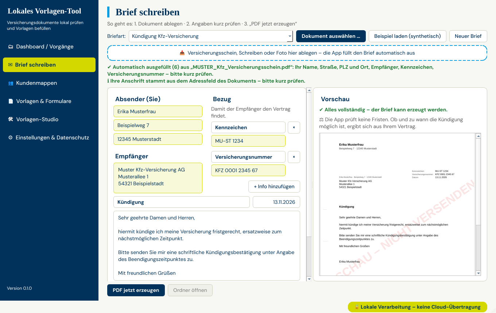
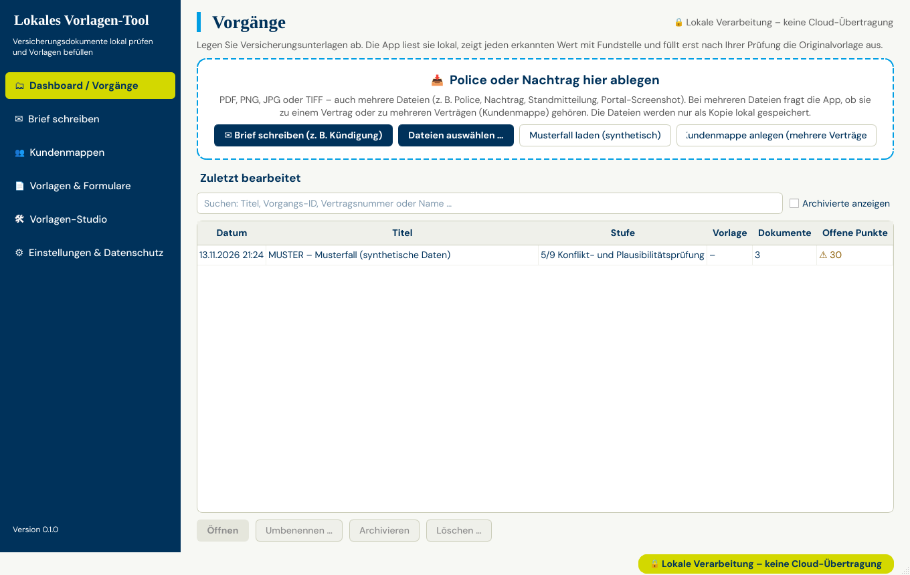
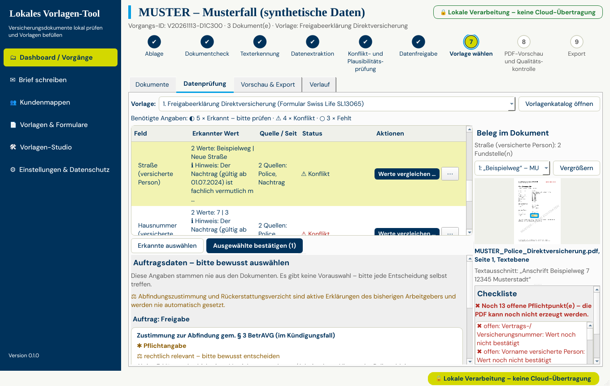
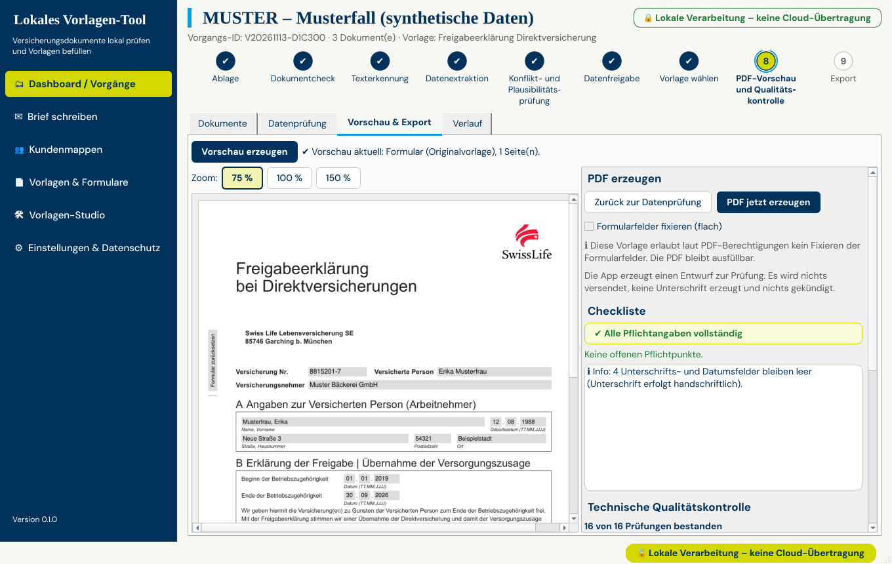

# Lokales Vorlagen-Tool

**Kurz gesagt:**

1. Die App liest Versicherungsunterlagen (PDF, Scan, Screenshot) und zeigt jeden erkannten Wert mit Fundstelle an.
2. Erst wenn ein Mensch die Werte geprüft und bestätigt hat, füllt sie die **unveränderte Originalvorlage** des Versicherers aus (Swiss Life SL13065 und SL18477) oder erzeugt ein **Kundenschreiben nach DIN 5008** (z. B. Kündigung, Widerruf).
3. Alles läuft **nur auf dem eigenen Rechner (LOCAL ONLY)**: keine Cloud, keine Telemetrie (keine Nutzungsdaten), keine automatische Übermittlung an Dritte.

| Stand | Wert |
|---|---|
| Version | 0.1.0 (Release 1) |
| Getestet | nur unter **Linux** (Ubuntu 24.04, Python 3.13, PySide6 6.12, Tesseract 5.3.4) |
| Windows / macOS | Einrichtungs- und Build-Skripte sind vorhanden, wurden aber **noch nicht** auf diesen Systemen ausgeführt |
| Tests | 1428 automatische Tests bestanden, 0 fehlgeschlagen (Lauf am 13.11.2026, inklusive der langsamen Tests). Einzelheiten: [docs/TESTBERICHT.md](docs/TESTBERICHT.md) |
| Lizenz | Unlicense (siehe `LICENSE`); Schriften Liberation Sans, DM Sans und Tinos unter SIL Open Font License |
| Gestaltung | nach dem tecis Corporate Design Manual 1.0 (Farben, DM Sans, Tinos) – siehe [docs/GESTALTUNG.md](docs/GESTALTUNG.md) |

**Der schnellste Weg – „Brief schreiben“:** Dokument ablegen, die App füllt Absender, Empfänger, Versicherungsnummer und Kennzeichen aus, kurz prüfen, „PDF jetzt erzeugen“. Anleitung: [docs/BEDIENUNG.md, Abschnitt 0](docs/BEDIENUNG.md#0-der-schnellste-weg-brief-schreiben).





---

## Inhalt

- [Funktionsumfang](#funktionsumfang)
- [Musterfall in 2 Minuten](#musterfall-in-2-minuten)
- [Kundenmappen (mehrere Verträge auf einmal)](#kundenmappen-mehrere-verträge-auf-einmal)
- [Lokale KI (optional)](#lokale-ki-optional)
- [Systemvoraussetzungen](#systemvoraussetzungen)
- [Installation und Start](#installation-und-start)
- [Wo liegen Daten und Exporte?](#wo-liegen-daten-und-exporte)
- [Build (eigenständige App)](#build-eigenständige-app)
- [Update](#update)
- [Fehlerbehebung](#fehlerbehebung)
- [Projektstruktur](#projektstruktur)
- [Weitere Dokumentation](#weitere-dokumentation)

---

## Funktionsumfang

### Ablauf in 9 Stufen

| Stufe | Was passiert | Wo in der App |
|---|---|---|
| 1 Ablage | Dateien ablegen: PDF, PNG, JPG, TIFF, bis 200 MB je Datei, mehrere Dateien je Vorgang. Die App speichert eine **schreibgeschützte Kopie**. Ihre Originaldatei bleibt unverändert. | Dashboard, Reiter „Dokumente“ |
| 2 Dokumentcheck | Dateityp (am Dateiinhalt erkannt, nicht an der Endung), Größe, Seitenzahl, Passwort, Beschädigung, Drehung, Auflösung, doppelte Dateien. | Reiter „Dokumente“ |
| 3 Texterkennung | Zuerst die Textebene des PDFs (Text, der schon im PDF gespeichert ist). Nur Seiten ohne brauchbaren Text liest die App per OCR (automatische Texterkennung aus dem Bild) mit Tesseract, Sprachen Deutsch und Englisch. | Reiter „Dokumente“ |
| 4 Datenextraktion | Regeln suchen Beschriftung und Wert (z. B. „Versicherungsnummer“ links, Wert rechts). Jeder Wert hat Quelle, Seite und Textausschnitt. | Reiter „Datenprüfung“ |
| 5 Konflikt- und Plausibilitätsprüfung | Nennen zwei Dokumente unterschiedliche Werte, entsteht ein **Konflikt**. Die App entscheidet nicht selbst. Dazu Prüfungen: IBAN-Prüfziffer, PLZ, Datum, Betrag, Vertragsnummer, Plausibilität je Vorlage. | Reiter „Datenprüfung“ |
| 6 Datenfreigabe | Sie bestätigen, korrigieren oder markieren Werte. Auftragsdaten (z. B. Kündigungstermin, Zustimmungen) wählen Sie selbst – es gibt keine Vorauswahl. | Reiter „Datenprüfung“ |
| 7 Vorlage wählen | Nur Vorlagen mit Status „Aktiv“ sind wählbar. Die Vorlage kann auch direkt nach dem Ablegen gewählt werden. | Reiter „Datenprüfung“ oder „Vorlagen & Formulare“ |
| 8 Vorschau und Qualitätskontrolle | Probe-PDF, Checkliste offener Punkte und technische Prüfung (QA = Qualitätskontrolle). Jede Seite wird mit zwei Programmen dargestellt (MuPDF und PDFium). | Reiter „Vorschau & Export“ |
| 9 Export | Erst nach Klick auf „PDF jetzt erzeugen“ und bestandener QA. Die PDF landet im Exportordner. Ein Exportprotokoll ohne Personendaten wird ergänzt. | Reiter „Vorschau & Export“ |

**Mehrere Verträge auf einmal:** In einer **Kundenmappe** legen Sie alle Unterlagen einer Kundin ab. Die App bildet je Vertrag einen Vorgang. Siehe [Kundenmappen](#kundenmappen-mehrere-verträge-auf-einmal).

**Optional:** Eine lokale KI (Ollama mit GLM-OCR, Qwen3-VL und optional Gemma 4) kann schwer lesbare Seiten zusätzlich lesen. Sie ist standardmäßig **aus**. Ihre Vorschläge müssen Sie wie alle anderen Werte prüfen. Siehe [Lokale KI](#lokale-ki-optional).

### Vorlagenkatalog (9 Einträge)

| Nr. | Vorlage | Gruppe | Art | Status bei Auslieferung |
|---|---|---|---|---|
| 1 | Freigabeerklärung Direktversicherung – Swiss Life **SL13065** (Stand 09/2024, 1 Seite) | Swiss Life bAV | Originalvorlage (Formular des Versicherers) | **Aktiv** |
| 2 | Übernahme der Versicherungsnehmer-Eigenschaft – Swiss Life **SL18477** (Stand 09/2024, 6 Seiten) | Swiss Life bAV | Originalvorlage | **Aktiv** |
| 3 | Ordentliche Kündigung | Kündigung & Widerruf | Brief nach DIN 5008 (wird erzeugt) | **Aktiv** (Brief) |
| 4 | Außerordentliche Kündigung / Sonderkündigung | Kündigung & Widerruf | Brief nach DIN 5008 | **Aktiv** (Brief) |
| 5 | Befristete Beitragsfreistellung / Beitragsreduzierung (HDI) | Beitragsmanagement | Brief nach DIN 5008 | **Aktiv** (Brief) |
| 6 | Beitragserhöhung / Vertragsanpassung (Continentale) | Beitragsmanagement | Brief nach DIN 5008 | **Aktiv** (Brief) |
| 7 | Bestandsübertrag / Betreuerwechsel an tecis AG | Betreuung & Enthaftung | Brief nach DIN 5008 | **Aktiv** (Brief) |
| 8 | Widerruf – Antrag / Vertrag / Kündigung | Kündigung & Widerruf | Brief nach DIN 5008 | **Aktiv** (Brief) |
| 9 | Haftungsfreistellung Arbeitskraftabsicherung (tecis) | Betreuung & Enthaftung | – | **Originalvorlage fehlt** (nicht nutzbar) |

- **Zusammengefasst:** 2 Swiss-Life-Originale aktiv, 6 Briefe nach DIN 5008 werden erzeugt, 1 Original fehlt.
- Ein **Brief nach DIN 5008** ist ein Kundenschreiben an den Versicherer. Es ist kein nachgebautes Versicherer-Formular. DIN 5008 ist die deutsche Norm für den Aufbau von Geschäftsbriefen.
- Für die Einträge 3–8 kann zusätzlich eine Originalvorlage des Versicherers importiert werden. Für Eintrag 9 ist das Original Pflicht. Siehe [docs/FEHLENDE_VORLAGEN.md](docs/FEHLENDE_VORLAGEN.md).
- Die mitgelieferten Swiss-Life-PDFs werden unverändert verwendet. Ob ein neuerer Formularstand gilt, prüfen Sie bitte beim Versicherer.

### Was die App bewusst **nicht** tut

- Keine Unterschrift und kein Unterschriftsdatum. Diese Felder bleiben immer leer.
- Keine rechtlich relevante Auswahl von allein (z. B. Zustimmung zur Abfindung, Verzicht auf Rückerstattung, PeP-Angabe, Zahlungsart).
- Keine Fristberechnung und keine Rechtsprüfung. Hinweise zu Paragrafen sind „prüfbedürftig“ und keine Rechtsberatung.
- Kein Versand. Sie drucken, unterschreiben und versenden selbst.
- Kein „Fixieren“ (Umwandeln der Formularfelder in festen Seiteninhalt) bei den Swiss-Life-Vorlagen, weil deren PDF-Rechte das nicht erlauben.

---

## Musterfall in 2 Minuten

Der Musterfall nutzt **nur erfundene Daten**. Jede Seite trägt den Aufdruck „MUSTER – KEINE ECHTDATEN“ (Versicherer „Beispiel Lebensversicherung AG (MUSTER)“, versicherte Person „Erika Musterfrau“).

1. App starten: `python app.py` (siehe [Installation](#installation-und-start)).
2. Im **Dashboard** auf **„Musterfall laden (synthetisch)“** klicken. Die App legt einen Vorgang mit drei Dokumenten an (Police, Nachtrag, gescannte Standmitteilung) und liest sie lokal aus.
3. Reiter **„Datenprüfung“** → oben bei „Vorlage“ **„1. Freigabeerklärung Direktversicherung“** wählen. Die Tabelle zeigt jetzt oben nur die Felder, die diese Vorlage braucht.
4. Erkannte Werte prüfen. Stimmen sie, die Zeilen auswählen und **„Ausgewählte bestätigen“** klicken (z. B. Vertragsnummer, Name, Geburtsdatum).
5. **Konflikte lösen:** Police und Nachtrag nennen verschiedene Anschriften der versicherten Person (Beispielweg 7, 12345 Musterstadt bzw. Neue Straße 3, 54321 Beispielstadt). Je Feld **„Werte vergleichen …“** öffnen, Fundstelle ansehen, **„Diesen Wert übernehmen“**. Der Hinweis „vermutlich maßgeblich“ ist nur eine Orientierung.
6. **Fehlende Werte eintragen:** Beginn und Ende der Betriebszugehörigkeit stehen nicht in der Police. Mit **„Eintragen …“** z. B. `01.01.2019` und `30.06.2026` eingeben (Musterwerte).
7. **Auftragsdaten** bewusst wählen: „Zustimmung zur Abfindung“ und „Verzicht auf Rückerstattung“ jeweils **Ja oder Nein**. Achtung: Beim Feld „Rückerstattung“ bedeutet ein Kreuz **KEINE** Rückerstattung.
8. Reiter **„Vorschau & Export“** → **„Vorschau erzeugen“**. Die Checkliste sollte keine offenen Pflichtpunkte mehr zeigen.
9. **„PDF jetzt erzeugen“** → bestätigen. Ergebnis im Exportordner, z. B. `2026-11-13_SWISSLIFE_SL13065_Freigabe_V20261113-AB12CD.pdf`.

Geprüft am 13.11.2026 über die Programmlogik (`AppService`): Der Ablauf führt zu einer PDF mit bestandener Qualitätskontrolle (16 von 16 Prüfungen). Die Beschriftungen stammen aus der Oberfläche; kleine Abweichungen sind möglich, solange die Oberfläche noch fertiggestellt wird.

| Datenprüfung | Vorschau & Export |
|---|---|
|  |  |

---

## Kundenmappen (mehrere Verträge auf einmal)

**Kurz gesagt:** Eine Kundin hat oft mehrere Verträge. In einer **Kundenmappe** legen Sie alle Unterlagen auf einmal ab. Die App sortiert sie nach Vertragsnummer in Vorgänge. Je Vertrag wählen Sie den **Anwenderwunsch** (die Vorlage, z. B. Kündigung oder Freigabe) und prüfen die Werte. Danach erzeugt **„Alle fertigen erzeugen“** alle fertig geprüften Verträge in einem Durchgang.

| Regel | Beispiel |
|---|---|
| Gleiche Vertragsnummer → **ein** Vorgang | Police und Nachtrag zu demselben Vertrag landen zusammen |
| Andere Vertragsnummer → **eigener** Vorgang | 3 Verträge → 3 Vorgänge |
| Später nachgereichte Datei → zum vorhandenen Vorgang ihres Vertrags | Der Nachtrag kommt eine Woche später |
| Keine Vertragsnummer erkannt → eigener Vorgang für diese Datei | Bitte prüfen, zu welchem Vertrag die Datei gehört |
| Prüfung durch einen Menschen bleibt Pflicht | „Alle fertigen erzeugen“ überspringt Vorgänge ohne Anwenderwunsch oder mit offenen Pflichtpunkten – mit Begründung |

Ablauf in der App:

1. Seitenleiste **„Kundenmappen“** → **„Neue Kundenmappe“**. Oder im Dashboard mehrere Dateien ablegen und **„Mehrere Verträge – Kundenmappe“** wählen. Den Namen der Mappe möglichst ohne vollen Kundennamen wählen (z. B. ein Kürzel); er erscheint in den Vorgangstiteln.
2. Dateien ablegen. Die **„Warteschlange“** arbeitet sie nacheinander ab. Status je Datei: Wartet, Wird ausgewertet, Fertig, Passwort erforderlich, Nicht verarbeitbar, Abgebrochen. Passwörter fragt die App danach je Datei ab.
3. **„Verträge in dieser Mappe“** zeigt je Vertrag: Vorgang, Versicherer, die letzten Stellen der Vertragsnummer, Dokumente, Anwenderwunsch, Status („✔ bereit“ oder offene Punkte), erzeugte Datei.
4. Je Vertrag den **„Anwenderwunsch“** wählen und mit **„Prüfen & bearbeiten“** die Werte wie gewohnt prüfen (Abschnitt „Musterfall“ oben).
5. **„Alle fertigen erzeugen“** → **„Jetzt erzeugen“**. Jede PDF durchläuft dieselbe Qualitätskontrolle wie beim einzelnen Vorgang.

Schritt für Schritt: [docs/BEDIENUNG.md – Kundenmappe](docs/BEDIENUNG.md#3-kundenmappe-1-kundin-mehrere-verträge).

---

## Lokale KI (optional)

**Kurz gesagt:** Die App funktioniert ohne KI. Mit KI: **GLM-OCR** liest schwierige Scans und Tabellen. **Qwen3-VL** springt ein, wenn GLM-OCR fehlt oder scheitert. **Gemma 4** kann optional gegenprüfen. Alles läuft lokal über **Ollama** (kostenloses Programm, das KI-Modelle auf dem eigenen Rechner ausführt) unter `127.0.0.1`. Nichts geht in die Cloud. KI-Werte bestätigt immer ein Mensch.

| Profil | Modelle | Download | Passt zu (Richtwerte, nicht auf Zielgeräten gemessen) |
|---|---|---|---|
| kompakt | `glm-ocr` | 2,66 GB | ab 8 GB Arbeitsspeicher; Mac mit Apple Silicon oder 64-Bit-Windows (Grafikkarte nicht erforderlich) |
| **standard** (empfohlen) | `glm-ocr` + `qwen3-vl:4b-instruct` | 6,00 GB | 16 GB; Mac mit Apple Silicon oder PC mit NVIDIA-Grafikkarte (6–8 GB Grafikspeicher) |
| maximal | zusätzlich `gemma4:e4b` | 12,58 GB | 32 GB; Mac M-Pro/Max oder PC mit NVIDIA-Grafikkarte (12 GB Grafikspeicher) |

Einrichten – das Skript prüft den Rechner, schlägt ein Profil vor und fragt vor jedem Schritt:

```bash
./scripts/install_local_ai_macos.sh --dry-run      # macOS: nur prüfen, nichts ändern
./scripts/install_local_ai_macos.sh standard       # macOS: einrichten (Modelle erst nach Rückfrage)
```

```powershell
powershell -ExecutionPolicy Bypass -File scripts\install_local_ai_windows.ps1 -DryRun
powershell -ExecutionPolicy Bypass -File scripts\install_local_ai_windows.ps1 -Profile standard
```

Oder von Hand, wenn Ollama schon installiert ist:

```bash
ollama pull glm-ocr
ollama pull qwen3-vl:4b-instruct
ollama pull gemma4:e4b      # nur für die Gegenprüfung
ollama run qwen3-vl:4b-instruct      # kurzer Test im Chat, beenden mit /bye
```

Danach in der App: „Einstellungen & Datenschutz“ → „Lokale KI (optional)“ → Profil übernehmen (z. B. „Profil „Standard“ übernehmen“) → in der Tabelle „Lokale KI-Modelle“ je Modell „Herunterladen …“ (nur nach ausdrücklicher Zustimmung) → „Lokale KI aktivieren“ → „Status prüfen“. Unter „Modellauswahl“ legen Sie fest, welches Modell aktiv läuft („Aktives Modell“, „Ausweichmodell“, „Gegenprüfung“).

> **Ehrlicher Stand:** Die Skripte wurden nicht auf einem echten Mac oder Windows-PC ausgeführt (macOS-Skript: Testlauf und nachgebildete Befehle unter Linux; Windows-Skript: nicht ausgeführt). Gemessene Laufzeiten stehen nur in [docs/BENCHMARK.md](docs/BENCHMARK.md). Alles Weitere: [docs/LOKALE_KI.md](docs/LOKALE_KI.md).

---

## Systemvoraussetzungen

| Bereich | Anforderung | Status |
|---|---|---|
| Linux (x86_64) | Ubuntu 24.04 mit Python 3.13 | **getestet** (Entwicklungsumgebung: 4 CPU-Kerne, 15 GB RAM, keine Grafikkarte) |
| Windows | Windows 10 oder 11, 64 Bit (Annahme) | Zielplattform, **nicht getestet** |
| macOS | Apple Silicon oder Intel | Zielplattform, **nicht getestet**. Die PyInstaller-Spezifikation trägt macOS 11 als Mindestversion ein; ob die verwendete Qt-Version darauf läuft, ist nicht geprüft. |
| Python | 3.11 oder neuer (getestet: 3.13) | nur für Start aus dem Quellcode und für den Build nötig |
| Tesseract OCR | Version 5 mit Sprachpaket **Deutsch** (`deu`) | optional, aber für Scans und Bilder nötig. Ohne Tesseract liest die App nur PDFs mit Textebene. |
| Speicherplatz | Python-Pakete unter Linux gemessen: ca. 0,9 GB (davon PySide6 ca. 0,7 GB) | Windows/macOS nicht gemessen |
| Bildschirm | Fenster mindestens 1100 × 700 Pixel | – |
| Lokale KI (optional) | Ollama (für die Modelle ab Version 0.30.0) und je nach Profil 2,66–12,58 GB Modelle; Richtwerte 8–32 GB Arbeitsspeicher | Profile und Grafikkarten: [docs/LOKALE_KI.md](docs/LOKALE_KI.md) |

---

## Installation und Start

Alle Befehle im **Projektordner** ausführen (der Ordner mit `app.py`).

### Windows

1. **Python** 3.11 oder neuer installieren (python.org). Der Python-Launcher `py` wird vom Skript bevorzugt, sonst `python`.
2. **PowerShell** im Projektordner öffnen und ausführen:

   ```powershell
   powershell -ExecutionPolicy Bypass -File scripts\setup_windows.ps1 -InstallTesseract
   ```

   - `-ExecutionPolicy Bypass` erlaubt nur für diesen Aufruf das Ausführen des Skripts. Die Systemeinstellung bleibt unverändert.
   - Das Skript legt die virtuelle Umgebung `.venv` an (ein eigener Python-Ordner nur für dieses Projekt) und installiert die Abhängigkeiten mit `pip install -e ".[dev]"`.
   - Es sucht Tesseract im PATH und unter `C:\Program Files\Tesseract-OCR\tesseract.exe`.
   - Mit `-InstallTesseract` installiert es Tesseract per `winget install --id UB-Mannheim.TesseractOCR` (Build der UB Mannheim). **Bitte bei der Installation das Sprachpaket „German“ auswählen.** Ob `winget` das Sprachpaket automatisch mitinstalliert, wurde nicht geprüft.
   - Ohne `-InstallTesseract` prüft das Skript nur und zeigt einen Hinweis.
3. Sprachpaket prüfen – in der Liste muss `deu` stehen:

   ```powershell
   & "C:\Program Files\Tesseract-OCR\tesseract.exe" --list-langs
   ```

4. **Starten:**

   ```powershell
   .\.venv\Scripts\python.exe app.py
   ```

### macOS

1. **Homebrew** installieren (siehe brew.sh). **Python** 3.11 oder neuer installieren, z. B. `brew install python@3.13` oder von python.org.
2. **Terminal** im Projektordner öffnen und ausführen:

   ```bash
   ./scripts/setup_macos.sh --install-tesseract
   ```

   - Legt `.venv` an und installiert die Abhängigkeiten (`pip install -e ".[dev]"`).
   - Mit `--install-tesseract`: `brew install tesseract tesseract-lang`. Das Paket `tesseract-lang` enthält das Sprachpaket Deutsch.
   - Bestimmte Python-Version verwenden: `PYTHON=python3.13 ./scripts/setup_macos.sh --install-tesseract`
3. **Starten:**

   ```bash
   ./.venv/bin/python app.py
   ```

### Linux (nur Entwicklung und Test)

Für Linux gibt es kein eigenes Skript. Die folgenden Schritte entsprechen dem macOS-Skript:

```bash
python3 -m venv .venv
./.venv/bin/python -m pip install --upgrade pip
./.venv/bin/python -m pip install -e ".[dev]"
./.venv/bin/python app.py
```

Tesseract mit deutschem Sprachpaket über die Paketverwaltung installieren (unter Debian/Ubuntu heißen die Pakete in der Regel `tesseract-ocr` und `tesseract-ocr-deu`).

### Befehle der App

| Befehl | Wirkung |
|---|---|
| `python app.py` | Startet die Oberfläche. Beim ersten Start erscheint ein kurzer Hinweis zu LOCAL ONLY. |
| `python app.py --selftest` | Selbstprüfung ohne Oberfläche: Daten- und Exportordner, Status aller 9 Vorlagen, OCR, lokale KI, ein Musterfall und – wenn Tesseract vorhanden ist – ein gescannter Musterbeleg (nur synthetische Daten, in einem temporären Ordner). Rückgabewert 0 = in Ordnung, 1 = Fehler, 2 = Datenablage nicht nutzbar. |
| `python app.py --version` | Zeigt `Lokales Vorlagen-Tool 0.1.0`. |
| `lokales-vorlagen-tool` | Gleicher Start wie `python app.py`, sobald das Paket mit `pip install -e .` installiert ist (in `.venv` aufrufen). Eingetragen in `pyproject.toml`; nicht gesondert getestet. |
| `python scripts/generate_samples.py [Ordner]` | Erzeugt die synthetischen Musterdateien (Standard: `tests/fixtures/synthetic`). |
| `python scripts/benchmark_extraction.py` | Misst die Erkennung auf synthetischen Testdokumenten (richtig / falsch / fehlt). Mit `--with-vlm` zusätzlich mit lokaler KI. Siehe [docs/BENCHMARK.md](docs/BENCHMARK.md). |
| `python -m pytest -q -m "not slow"` | Automatische Tests ohne die langsamen OCR-/Darstellungstests. |

Unter Windows statt `python` den Pfad `.\.venv\Scripts\python.exe` verwenden, unter macOS/Linux `./.venv/bin/python`.

Beispielausgabe der Selbstprüfung (Linux, 13.11.2026, gekürzt):

```text
Lokales Vorlagen-Tool 0.1.0 – Selbstprüfung
[  OK  ] Vorlage 1: Freigabeerklärung Direktversicherung – Aktiv (Originalvorlage)
[  OK  ] Vorlage 3: Ordentliche Kündigung – Aktiv (Brief DIN 5008)
[ INFO ] Vorlage 9: Haftungsfreistellung Arbeitskraftabsicherung – Originalvorlage fehlt (—)
[  OK  ] OCR tesseract: Tesseract 5.3.4 bereit (Sprachen: deu+eng).
[ INFO ] OCR rapidocr: RapidOCR ist nicht installiert (optional: pip install rapidocr_onnxruntime).
[ INFO ] Lokale KI: Deaktiviert – Die lokale KI ist ausgeschaltet. Die App funktioniert vollständig ohne sie.
[  OK  ] Musterfall: Textebene und Extraktion funktionieren.
[  OK  ] Texterkennung (OCR): gescannter Musterbeleg korrekt gelesen.
[  OK  ] Selbstprüfung abgeschlossen.
```

**Umgebungsvariablen** (optional): `VORLAGEN_TOOL_DATA_DIR` setzt den Datenordner, `VORLAGEN_TOOL_EXPORT_DIR` den Exportordner. Praktisch für Tests oder eine getrennte Ablage.

---

## Wo liegen Daten und Exporte?

| Startart | Datenordner | Exportordner (Standard) |
|---|---|---|
| Aus dem Quellcode (`python app.py`) | `<Projektordner>/user_data` | `<Projektordner>/exports` |
| Gebaute App unter Windows | `%LOCALAPPDATA%\LokalesVorlagenTool` | `<Benutzerordner>\Documents\Vorlagen-Exporte` |
| Gebaute App unter macOS | `~/Library/Application Support/LokalesVorlagenTool` | `~/Documents/Vorlagen-Exporte` |
| Gebaute App unter Linux | `~/.local/share/lokales-vorlagen-tool` (bzw. `$XDG_DATA_HOME/lokales-vorlagen-tool`) | `~/Documents/Vorlagen-Exporte` |

- Den Exportordner können Sie in **„Einstellungen & Datenschutz“ → „Exportordner ändern …“** ändern. Die App prüft vorher, ob sie dort schreiben darf.
- `user_data/` und `exports/` sind von Git ausgeschlossen (`.gitignore`). Sie können echte Kundendaten enthalten und dürfen nie eingecheckt werden.
- **Achtung Cloud-Ordner:** Wird „Dokumente“ mit iCloud Drive, OneDrive o. Ä. synchronisiert, verlassen die exportierten PDFs über diesen Dienst den Rechner. Wählen Sie dann einen nicht synchronisierten Exportordner. Mehr dazu in [docs/DATENSCHUTZ.md](docs/DATENSCHUTZ.md).

Inhalt des Datenordners:

| Pfad | Inhalt |
|---|---|
| `vorgaenge.sqlite3` | Lokale Datenbank (SQLite): Vorgänge, erkannte Texte und Werte, Verlauf, Exportliste, Vorlagenversionen |
| `cases/<Vorgangs-ID>/documents/` | Schreibgeschützte Kopien der Dokumente. Dateiname = Dokument-ID (z. B. `D-1A2B3C4D.pdf`), ohne Personennamen |
| `templates/<Katalog-ID>/<Version>/` | Im Vorlagen-Studio importierte Originalvorlagen (`original.pdf`, `mapping.json`, `meta.json`) |
| `logs/app.log` | Technisches Protokoll ohne Personendaten (rotierend: 1 MB, 3 Sicherungen) |
| `logs/export_log.jsonl` | Exportprotokoll ohne Personendaten |
| `settings.json` | Einstellungen |
| `tmp/` | Temporäre Arbeitsordner (Vorschau, Export). Werden nach Gebrauch gelöscht; Reste älter als 24 Stunden räumt die App beim Start auf |

---

## Build (eigenständige App)

Ein Build erzeugt mit **PyInstaller** eine App, die ohne installiertes Python läuft. PyInstaller baut nur für das System, auf dem es läuft: Windows-Build unter Windows, macOS-Build unter macOS.

> **Ehrlicher Stand:** Die Build-Skripte wurden in dieser Linux-Umgebung **nicht** ausgeführt. Windows- und macOS-Builds sind ungetestet.

| | Windows | macOS |
|---|---|---|
| Voraussetzung | `scripts\setup_windows.ps1` wurde ausgeführt | `./scripts/setup_macos.sh` wurde ausgeführt |
| Aufruf | `powershell -ExecutionPolicy Bypass -File scripts\build_windows.ps1` | `./scripts/build_macos.sh` (mit DMG: `./scripts/build_macos.sh --dmg`) |
| Ablauf | Tests (`-m "not slow"`) → PyInstaller mit `packaging/lokales_vorlagen_tool.spec` → Probestart mit `--version` → ZIP | Tests → PyInstaller → Probestart mit `--version` → Ad-hoc-Signatur → optional DMG |
| Ergebnis | `dist\LokalesVorlagenTool\LokalesVorlagenTool.exe` und `dist\LokalesVorlagenTool-windows.zip` | `dist/LokalesVorlagenTool.app` und optional `dist/LokalesVorlagenTool-macos.dmg` |

Schlagen die Tests fehl, bricht der Build ab.

**Im Build enthalten:** Originalvorlagen (`assets/templates/originals`), Schriften (`assets/fonts`), Konfiguration (`config/`: Katalog, Feldzuordnungen, Brieftexte).

**Nicht enthalten:**

- **Tesseract OCR** – muss auf jedem Rechner separat installiert werden.
- Ollama und KI-Modelle (optional, separat).
- Docling und RapidOCR (optionale OCR-Verfahren).
- Die Dokumentation `docs/`. Der Knopf „Anleitung öffnen“ in den KI-Einstellungen findet `docs/LOKALE_KI.md` daher nur beim Start aus dem Quellcode.
- Keine Kundendaten, kein `user_data/`, kein `exports/`.
- Ein eigenes Programmsymbol: `assets/icons/` ist leer, es wird das Standardsymbol verwendet.

**Code-Signatur (digitale Herkunftsbestätigung):**

- **macOS:** Das Skript signiert nur „ad hoc“ (ohne Apple-Entwicklerkonto). Auf anderen Macs warnt Gatekeeper (Apples Schutzfunktion) beim ersten Öffnen. Öffnen dann per Rechtsklick → „Öffnen“ oder unter „Systemeinstellungen → Datenschutz & Sicherheit“. Für die Weitergabe an andere: Signatur mit „Developer ID“-Zertifikat und Notarisierung (Prüfung durch Apple) – dafür ist ein Apple-Entwicklerkonto nötig.
- **Windows:** Die `.exe` ist nicht signiert. Windows SmartScreen zeigt beim ersten Start „Der Computer wurde durch Windows geschützt“. Starten über „Weitere Informationen“ → „Trotzdem ausführen“. Für die Weitergabe: mit einem Code-Signing-Zertifikat signieren.

---

## Update

**Aus dem Quellcode:**

1. App schließen. Eine Sicherung des Datenordners (`user_data/`) wird empfohlen.
2. Neuen Stand holen und Abhängigkeiten aktualisieren:

   ```bash
   git pull
   ./.venv/bin/python -m pip install -e ".[dev]"        # macOS/Linux
   ```

   ```powershell
   git pull
   .\.venv\Scripts\python.exe -m pip install -e ".[dev]"  # Windows
   ```

   Alternativ das Einrichtungsskript erneut ausführen.
3. Selbstprüfung: `python app.py --selftest`.

**Gebaute App:** Programmordner bzw. `.app` ersetzen. Der Datenordner im Benutzerprofil bleibt unberührt.

Was beim Update passiert:

- **Ihre Daten bleiben erhalten.** `user_data/` und `exports/` sind von Git ausgeschlossen; `git pull` ändert sie nicht. Im Vorlagen-Studio importierte Vorlagen liegen ebenfalls im Datenordner.
- **Datenbank-Migrationen** (Anpassung der Datenbankstruktur) laufen beim Start automatisch. Angewendete Versionen stehen in der Tabelle `schema_migrations` der Datenbank.
- Eine Datenbank aus einer **neueren** Programmversion öffnet die App nicht. Meldung: „Die Datenbank stammt aus einer neueren Programmversion. Bitte die App aktualisieren.“ Ein Zurückstufen ist also nicht vorgesehen.
- Mitgelieferte Dateien in `config/` und `assets/` werden durch das Update ersetzt. Eigene Änderungen dort (z. B. an Brieftexten) vorher sichern oder in Git festhalten.

---

## Fehlerbehebung

| Problem | Ursache und Lösung |
|---|---|
| **„Tesseract ist nicht installiert oder wurde nicht gefunden“** bzw. Selbstprüfung: „Ohne Tesseract können nur PDFs mit Textebene ausgewertet werden.“ | Tesseract installieren (siehe oben). Die App sucht in dieser Reihenfolge: eingestellter Pfad → PATH → unter Windows `%ProgramFiles%\Tesseract-OCR`, `%ProgramFiles(x86)%\Tesseract-OCR`, `%LOCALAPPDATA%\Tesseract-OCR` und `%LOCALAPPDATA%\Programs\Tesseract-OCR` → unter macOS/Linux `/opt/homebrew/bin` (Homebrew auf Apple Silicon), `/usr/local/bin` (Homebrew auf Intel), `/usr/bin`. Liegt Tesseract woanders: „Einstellungen & Datenschutz“ → „Texterkennung (OCR)“ → „Tesseract-Programm“ → „Datei wählen …“ → „Übernehmen“. |
| **macOS: Im Terminal läuft `tesseract`, in der App nicht** | Aus dem Finder gestartete Apps kennen den PATH des Terminals nicht. Deshalb sucht die App Homebrew-Pfade selbst (siehe oben). Hilft das nicht, den Pfad in den Einstellungen eintragen (`which tesseract` im Terminal zeigt ihn). |
| **„Sprachpaket 'deu' fehlt“** | macOS: `brew install tesseract-lang`. Windows: Tesseract-Installation erneut starten und „German“ wählen. Prüfen mit `tesseract --list-langs`. |
| **Qt-Fehler beim Start**, z. B. „Could not load the Qt platform plugin …“ | Qt ist die Bibliothek für die Oberfläche (über PySide6). Meist ist die Installation unvollständig. In der `.venv` neu installieren: `python -m pip install --force-reinstall PySide6`. Unter Linux fehlen oft Systembibliotheken für die Fensterdarstellung (bei Qt 6 häufig `libxcb-cursor0`). Ohne Bildschirm (z. B. Server) startet die Oberfläche nicht; dort nur `--selftest` nutzen. Diese Hinweise sind allgemeiner Natur und wurden nicht auf allen Systemen nachgestellt. |
| **Passwortgeschütztes PDF** | Beim Hinzufügen fragt die App nach dem Passwort (Eingabe verdeckt). Das Passwort bleibt nur im Arbeitsspeicher, wird nie gespeichert. Bei falschem Passwort erscheint „Das Passwort war falsch“. **Nach einem Neustart** kennt die App das Passwort nicht mehr: Erkannte Werte bleiben erhalten, aber Seitenansicht und erneute Texterkennung brauchen es erneut („Passwort erforderlich – bitte erneut eingeben“). Derzeit hilft nur: Datei im Reiter „Dokumente“ entfernen und erneut hinzufügen. **Achtung:** Werte, die aus dieser Datei bestätigt wurden, setzt die App dabei zurück („Die Quelle dieses Werts wurde entfernt – bitte erneut prüfen.“). Sie müssen sie erneut bestätigen. Selbst eingetragene Werte bleiben. |
| **Vorlage hat Status „Fehler“**, z. B. „Prüfsumme der Originalvorlage passt nicht zur Feldzuordnung (Datei verändert oder ersetzt)“ | Die Prüfsumme (SHA-256, ein digitaler Fingerabdruck der Datei) der PDF passt nicht mehr. Die Original-PDF in `assets/templates/originals` wurde verändert, z. B. in einem PDF-Programm gespeichert. Lösung: unveränderte Datei wiederherstellen (aus Git oder dem Programmpaket). Eine neue Formularversion des Versicherers im **Vorlagen-Studio** importieren, Zuordnung prüfen und bestätigen. Weitere Gründe für „Fehler“ (Feld fehlt, Seitenzahl, Passwort) zeigt das Studio an. |
| **Exportordner nicht beschreibbar**: „Der Exportordner ist nicht erreichbar oder nicht beschreibbar …“ | „Einstellungen & Datenschutz“ → „Exportordner ändern …“ und einen eigenen Ordner wählen; „Standardordner verwenden“ setzt zurück. Netzlaufwerke und Cloud-Ordner vermeiden. |
| **„PDF jetzt erzeugen“ ist gesperrt** | Die Begründung steht neben dem Knopf: Vorschau fehlt oder ist veraltet, offene Pflichtpunkte in der Checkliste, oder technische Prüfung nicht bestanden. |
| **Start nicht möglich: „Die lokale Datenablage konnte nicht geöffnet werden“** | Rechte am Datenordner prüfen. „Die lokale Datenbank ist beschädigt …“: Sicherung von `vorgaenge.sqlite3` zurückspielen. |
| **Wo sind die Logs?** | `<Datenordner>/logs/app.log`. Sie enthalten nur technische Angaben (Zeit, Status, Fehlerklasse, Vorgangs-/Dokument-IDs). Für eine Fehlermeldung genügt diese Datei; bitte trotzdem vor der Weitergabe ansehen. |

---

## Projektstruktur

```text
app.py                      Startpunkt (python app.py)
pyproject.toml              Paketbeschreibung, Abhängigkeiten, Test- und Ruff-Einstellungen
assets/
  templates/originals/      Swiss-Life-Originalvorlagen SL13065, SL18477 (unverändert)
  fonts/                    Liberation Sans (eingebettete Schrift, OFL-Lizenz)
config/
  template_catalog.json     Vorlagenkatalog (9 Einträge, 4 Gruppen)
  field_schemas/            Feldzuordnungen der Swiss-Life-Vorlagen
  letter_templates/         Textbausteine der 6 DIN-5008-Briefe
src/insurance_app/
  core/                     Datenmodelle, Feldregister, Vorgang, Pfade, Einstellungen, AppService
  documents/                Eingangsprüfung, Klassifikation, Seitenbilder
  ocr/                      Textebene, Tesseract, optionale Verfahren, Seitenqualität
  extraction/               Normalisierung, Positionsregeln, Zusammenführung, Konflikte
  validation/               Feldprüfungen und Plausibilitätsregeln
  templates/                Katalog, Registry (Status, Versionen, Import), Werteauflösung, Studio
  pdf/                      Formular-Inspektion, Befüllung, Darstellung, Qualitätskontrolle
  letters/                  DIN-5008-Briefe: Textbausteine, Plausibilität, Satz, Brief-QA
  export/                   Dateinamen, Export, Exportprotokoll
  storage/                  SQLite-Datenbank und Vorgangsablage
  security/                 Log-Schwärzung, Netzwerk-Wächter, temporäre Ordner
  local_ai/                 Optional: Ollama-Client, Vision-Extraktion, Abgleich, Benchmark
  samples/                  Musterfall-Generator (synthetisch)
  ui/                       PySide6-Oberfläche
packaging/                  PyInstaller-Spezifikation
scripts/                    Einrichtung und Build für Windows/macOS, lokale KI (install_local_ai_*), Musterdateien, Benchmark
tests/                      Automatische Tests (nur synthetische Daten)
docs/                       Dokumentation
```

Für Entwickler: [ARCHITECTURE.md](ARCHITECTURE.md) (Aufbau), [IMPLEMENTATION_PLAN.md](IMPLEMENTATION_PLAN.md) (Plan und Entscheidungen), [TASKS.md](TASKS.md) (Aufgabenstand). Die Oberfläche spricht ausschließlich mit `core/service.py` (`AppService`).

---

## Weitere Dokumentation

| Datei | Inhalt |
|---|---|
| [docs/BEDIENUNG.md](docs/BEDIENUNG.md) | Bedienungsanleitung für Anwenderinnen und Anwender |
| [docs/DATENSCHUTZ.md](docs/DATENSCHUTZ.md) | Technische Schutzmaßnahmen, Speicherorte, Löschen, Pflichten des Betreibers |
| [docs/FELDZUORDNUNG_SWISSLIFE.md](docs/FELDZUORDNUNG_SWISSLIFE.md) | Jedes PDF-Feld von SL13065 und SL18477 mit Quelle und Regel |
| [docs/BRIEFVORLAGEN.md](docs/BRIEFVORLAGEN.md) | Die 6 DIN-5008-Briefe, Textbausteine, Hinweise, Prüfung der bisherigen Vorlagen |
| [docs/LOKALE_KI.md](docs/LOKALE_KI.md) | Optionale lokale KI: Modelle, Hardware, Einrichtung, Nur-lokal-Modus, Grenzen, ehrlicher Teststand |
| [docs/FEHLENDE_VORLAGEN.md](docs/FEHLENDE_VORLAGEN.md) | Fehlendes Original, optionale Originale, Import im Vorlagen-Studio |
| [docs/TESTBERICHT.md](docs/TESTBERICHT.md) | Testbericht |
| [docs/GESTALTUNG.md](docs/GESTALTUNG.md) | Gestaltung nach dem tecis Styleguide |
| [docs/BENCHMARK.md](docs/BENCHMARK.md) | Messungen zur Texterkennung |
