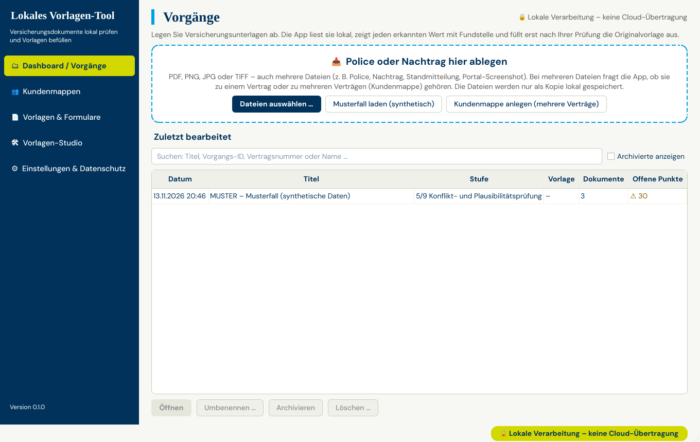
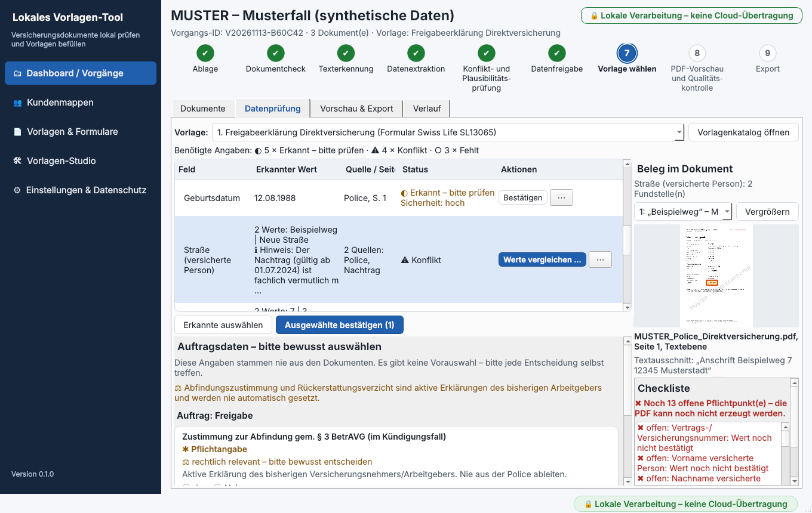
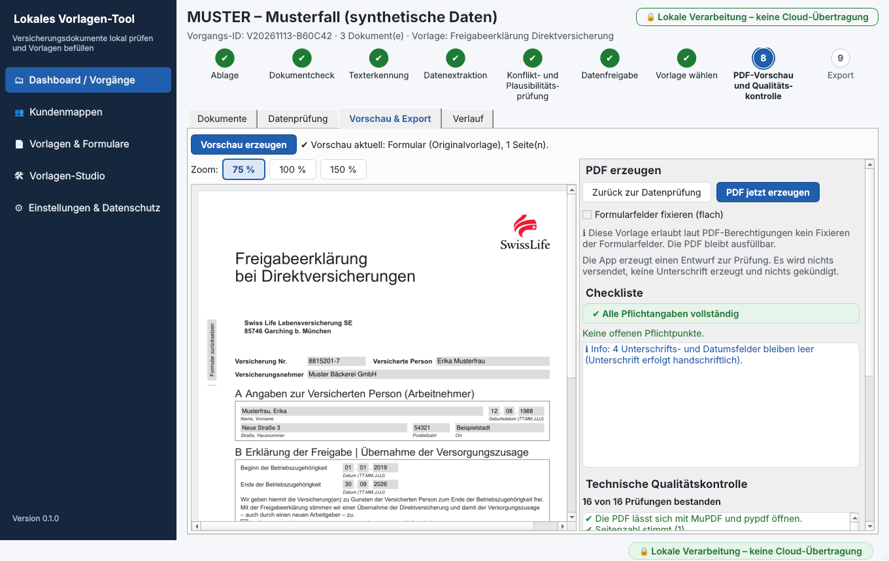
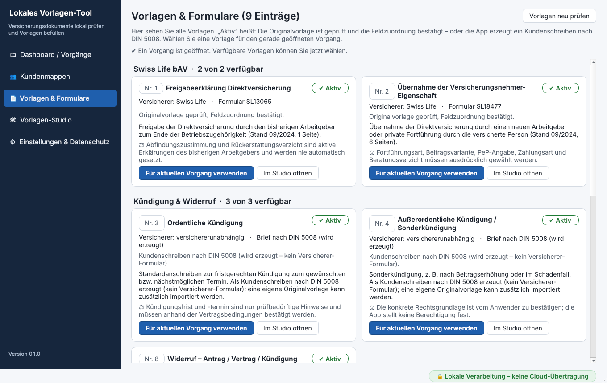
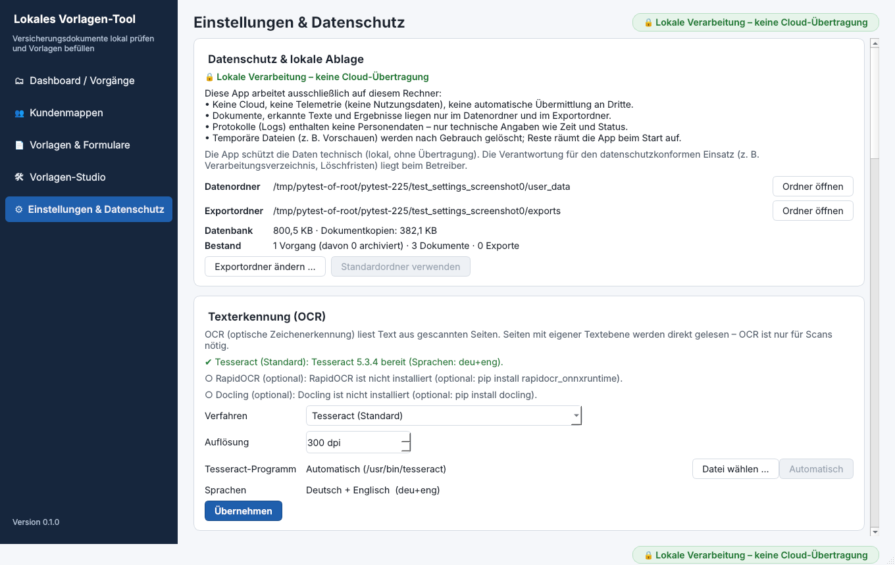

# Bedienungsanleitung

**Kurz gesagt:**

1. **Dateien ablegen** (Police, Nachtrag, Standmitteilung, Screenshot). Die App liest sie auf diesem Rechner aus.
2. **Vorlage wählen und Werte prüfen.** Jeder erkannte Wert zeigt, wo er im Dokument steht. Sie bestätigen oder korrigieren ihn.
3. **Auftragsdaten selbst wählen** (z. B. Kündigungstermin, Zustimmungen). Hier gibt es bewusst keine Vorauswahl.
4. **Vorschau ansehen, „PDF jetzt erzeugen“**, ausdrucken, **von Hand unterschreiben** und selbst versenden.

Nur Werte, die Sie bestätigt oder selbst eingetragen haben, kommen ins PDF. Alle Daten bleiben auf diesem Rechner. Die App versendet nichts.

**Mehrere Verträge einer Kundin?** Dann eine **Kundenmappe** anlegen (Abschnitt 3). Die App bildet je Vertrag einen Vorgang.

Zum Ausprobieren ohne echte Daten: **„Musterfall laden (synthetisch)“** auf dem Dashboard. Eine Schritt-für-Schritt-Runde steht im [README](../README.md#musterfall-in-2-minuten).

---

## Wichtige Begriffe

| Begriff | Bedeutung |
|---|---|
| **Vorgang** | Ein Arbeitsfall zu **einem** Vertrag: Dokumente, erkannte Werte, Auswahlen, erzeugte PDFs |
| **Vorgangs-ID** | Kurze Kennung wie `V20261113-AB12CD`. Sie enthält keine persönlichen Daten. |
| **Kundenmappe** | Sammelt die Vorgänge **einer** Kundin bzw. eines Kunden, z. B. 3 Verträge mit 3 Wünschen |
| **Warteschlange** | Liste der Dateien einer Kundenmappe, die die App nacheinander auswertet |
| **Anwenderwunsch** | Was mit einem Vertrag geschehen soll – technisch: die gewählte Vorlage (z. B. Kündigung, Freigabe) |
| **Originalvorlage** | Formular des Versicherers als PDF (z. B. Swiss Life SL13065). Die App füllt nur die vorhandenen Felder aus. |
| **Brief nach DIN 5008** | Kundenschreiben, das die App selbst setzt (DIN 5008 = Norm für Geschäftsbriefe) |
| **Vertragsdaten** | Angaben aus den Dokumenten, z. B. Vertragsnummer, Name, Geburtsdatum |
| **Auftragsdaten** | Was die Kundin oder der Kunde **will**, z. B. Kündigungstermin, Art der Fortführung. Steht nicht in den Dokumenten. |
| **Textebene** | Text, der schon im PDF gespeichert ist |
| **OCR** | Automatische Texterkennung aus dem Bild einer Seite (für Scans und Screenshots) |
| **Fundstelle / Beleg** | Datei, Seite und Textausschnitt, aus dem ein Wert stammt |
| **Konflikt** | Zwei Dokumente nennen unterschiedliche Werte für dasselbe Feld |
| **Checkliste** | Liste der offenen Punkte vor dem Export |
| **Qualitätskontrolle (QA)** | Technische Prüfung der fertigen PDF vor dem Export |

---

## Aufbau der App

Links ist die **Seitenleiste** mit fünf Bereichen. Unten im Fenster steht immer: „🔒 Lokale Verarbeitung – keine Cloud-Übertragung“.

| Bereich | Wofür |
|---|---|
| **Dashboard / Vorgänge** | Dateien ablegen, Musterfall laden, Vorgänge suchen, öffnen, umbenennen, archivieren, löschen |
| **Kundenmappen** | Mehrere Verträge einer Kundin auf einmal: Warteschlange, Verträge, „Alle fertigen erzeugen“ (Abschnitt 3) |
| **Vorlagen & Formulare** | Alle 9 Vorlagen mit Status ansehen und für den geöffneten Vorgang wählen |
| **Vorlagen-Studio** | Originalvorlagen importieren und Felder zuordnen (für Fortgeschrittene) |
| **Einstellungen & Datenschutz** | Speicherorte, Texterkennung, lokale KI, Export, Exportprotokoll |

Beim ersten Start erscheint ein kurzer Willkommenshinweis zu LOCAL ONLY.

---

## 1. Dashboard / Vorgänge

**Neuen Vorgang anlegen:** Dateien auf die Fläche **„Police oder Nachtrag hier ablegen“** ziehen oder **„Dateien auswählen …“** klicken.

- Erlaubt: PDF, PNG, JPG, TIFF – auch mehrere Dateien auf einmal. Ordner werden nicht übernommen.
- Die App legt einen neuen Vorgang an, übernimmt die Dateien als Kopie, öffnet den Vorgang und startet die Auswertung.
- Bei passwortgeschützten PDFs fragt die App nach dem Passwort. Es wird nicht gespeichert.

**Musterfall laden (synthetisch):** legt einen Vorgang mit erfundenen Dokumenten an („MUSTER – KEINE ECHTDATEN“). Gut zum Üben.

**Liste „Zuletzt bearbeitet“:** Spalten Datum, Titel, Stufe (welcher der 9 Schritte erreicht ist), Vorlage, Dokumente, Offene Punkte (noch nicht bestätigte Werte, Konflikte, unklare Angaben).

| Schaltfläche | Wirkung |
|---|---|
| Suchfeld | Suche nach Titel, Vorgangs-ID, Vertragsnummer oder Name – nur lokal |
| „Archivierte anzeigen“ | Blendet archivierte Vorgänge ein |
| „Öffnen“ (oder Doppelklick) | Vorgang öffnen |
| „Umbenennen …“ | Titel ändern – **bitte ohne sensible Daten** (z. B. keine Namen) |
| „Archivieren“ / „Wiederherstellen“ | Vorgang aus- bzw. wieder einblenden. Die Daten bleiben gespeichert. |
| „Löschen …“ | Vorgang **endgültig** löschen: Dokumentkopien, erkannte Daten, Verlauf. Nicht rückgängig zu machen. Bereits erzeugte PDFs im Exportordner bleiben erhalten. |

---

## 2. Vorgang

Oben stehen Titel und Vorgangs-ID. Darunter zeigt eine **Schrittanzeige** die 9 Arbeitsschritte (erledigt / aktuell / offen):

1 Ablage · 2 Dokumentcheck · 3 Texterkennung · 4 Datenextraktion · 5 Konflikt- und Plausibilitätsprüfung · 6 Datenfreigabe · 7 Vorlage wählen · 8 PDF-Vorschau und Qualitätskontrolle · 9 Export

Die Arbeit verteilt sich auf vier **Reiter**:

| Reiter | Schritte | Inhalt |
|---|---|---|
| **Dokumente** | 1–3 | Dateien, Prüfung, Texterkennung |
| **Datenprüfung** | 4–6 | Vorlage wählen, Werte prüfen, Auftragsdaten, Checkliste |
| **Vorschau & Export** | 7–9 | Probe-PDF, Qualitätskontrolle, PDF erzeugen |
| **Verlauf** | – | Wer hat wann was geändert |

### 2.1 Reiter „Dokumente“

Tabelle mit den Spalten **Dateiname**, **Seiten**, **Prüfung**, **Texterkennung je Seite** und **Auswertung**.

- **Prüfung:** „✔ in Ordnung“ oder ein Hinweis (z. B. geringe Auflösung, gedrehte Seite, beschädigt).
- **Texterkennung je Seite:** wie die Seite gelesen wurde (Textebene oder OCR) und wie gut: „gut lesbar“, „unsicher gelesen – bitte genau prüfen“ oder „kein Text gefunden“. Bei OCR steht die Wortsicherheit in Prozent dabei.
- **Dokumenttyp:** Die App schätzt den Typ (z. B. Police, Nachtrag, Standmitteilung, Vertragsübersicht aus einem Portal). Ist sie unsicher, können Sie den Typ in der Liste korrigieren.
- **Dublette:** Eine bereits vorhandene, inhaltsgleiche Datei wird erkannt („⧉ Dublette – nicht ausgewertet“).

| Schaltfläche | Wirkung |
|---|---|
| „Dateien hinzufügen …“ | weitere Unterlagen zum selben Vertrag hinzufügen |
| „Entfernen …“ | Datei aus dem Vorgang entfernen (die Kopie wird gelöscht) |
| „Ausschließen“ | Datei bleibt im Vorgang, wird aber nicht ausgewertet (z. B. veraltetes Dokument) |
| „Texterkennung & Auswertung starten“ | Text aller Dateien lesen und Werte mit Fundstelle erkennen. Läuft lokal; ein Fortschrittsfenster mit „Abbrechen“ erscheint. Bereits gelesene Dokumente bleiben beim Abbruch erhalten. |
| „Lokale KI-Zweitprüfung“ | schwierige Seiten zusätzlich mit dem lokalen Bildmodell lesen; nur aktiv, wenn die optionale lokale KI eingerichtet und bereit ist (siehe [LOKALE_KI.md](LOKALE_KI.md)) |
| „Weiter zur Datenprüfung →“ | zum nächsten Reiter |

Beim **Entfernen** oder **Ausschließen** einer Datei setzt die App Werte zurück, die Sie aus dieser Datei bestätigt hatten („Die Quelle dieses Werts wurde entfernt – bitte erneut prüfen.“). Selbst eingetragene Werte bleiben.

### 2.2 Reiter „Datenprüfung“

**Schritt 1 – Vorlage wählen.** Oben bei **„Vorlage:“** die gewünschte Vorlage wählen (oder „Vorlagenkatalog öffnen“). Danach zeigt die Tabelle oben nur die Felder, **die diese Vorlage braucht** („Für die gewählte Vorlage benötigt“). Weitere erkannte Angaben stehen eingeklappt darunter („Weitere erkannte Angaben (nicht erforderlich)“) und müssen nicht bestätigt werden. Die Vorlage kann jederzeit gewechselt werden.

**Schritt 2 – Werte prüfen.** Die Prüftabelle hat die Spalten **Feld**, **Erkannter Wert**, **Quelle / Seite**, **Status** und **Aktionen**.

- Klicken Sie eine Zeile an. Rechts erscheint der **Beleg**: die Quellseite mit **gelb markierter Fundstelle** und dem Textausschnitt. Mit „Vergrößern“ sehen Sie nur den Bereich um die Fundstelle.
- Je Zeile gibt es eine Hauptaktion als Schaltfläche, alle weiteren im Menü „⋯“:

| Aktion | Wann verwenden |
|---|---|
| **Bestätigen** | Der Wert ist richtig. |
| **Bearbeiten …** / **Eintragen …** | Wert selbst eintragen oder korrigieren. Das Eingabefeld zeigt das Format, z. B. `TT.MM.JJJJ` für ein Datum, `MM.JJJJ` für Monat/Jahr, `1.234,56` für Beträge. |
| **Als unklar markieren** | Der Wert ist nicht sicher lesbar oder nicht eindeutig. Die Markierung bleibt auch bei einer neuen Auswertung bestehen. |
| **Nicht relevant** | Die Angabe wird für diesen Vorgang nicht gebraucht und bleibt bewusst leer. |
| **Werte vergleichen …** | Bei Konflikten: alle Fundstellen nebeneinander, dann den richtigen Wert übernehmen (siehe Abschnitt 5). |
| **Zurücksetzen (Erkennung wiederherstellen)** | Eigene Entscheidung verwerfen und den erkannten Stand wiederherstellen. |

- **Mehrere Werte auf einmal bestätigen:** „Erkannte auswählen“ markiert alle noch nicht bestätigten Werte im oberen Abschnitt. „Ausgewählte bestätigen“ bestätigt sie. Konflikte und Felder ohne Wert werden dabei übersprungen und gemeldet.
- Prüfen Sie vor dem Bestätigen immer kurz den Beleg. „Bestätigen“ heißt: **Sie** haben den Wert geprüft.

**Schritt 3 – Auftragsdaten wählen.** Der Bereich **„Auftragsdaten – bitte bewusst auswählen“** unter der Prüftabelle zeigt die Angaben, die die gewählte Vorlage zusätzlich braucht (siehe Abschnitt 6).

- Ja/Nein- und Auswahlfelder haben **keine Vorauswahl**. Erst Ihr Klick speichert die Entscheidung.
- Textfelder werden beim Verlassen des Feldes oder mit der Eingabetaste übernommen. Eingabefehler erscheinen direkt darunter.
- „⚖ rechtlich relevant – bitte bewusst entscheiden“ markiert Angaben mit rechtlichen Folgen.
- „Auswahl löschen“ nimmt eine Entscheidung zurück. „nicht relevant“ lässt ein Feld bewusst leer. Bei rechtlich relevanten Ja/Nein- und Auswahlfeldern geht das nicht – dort bitte ausdrücklich wählen.
- Bei Briefen: **„Versicherer als Empfänger übernehmen“** übernimmt den bestätigten Versicherer als Empfänger. Die Anschrift ergänzen Sie selbst.
- Bei Briefen schlägt die App das **heutige Datum** als Briefdatum vor; manche Vorlagen schlagen weitere feste Werte vor (z. B. den Namen der neuen Betreuungsgesellschaft). Solche Vorschläge sind mit „Vorschlag der Vorlage – bitte prüfen“ markiert, und die Checkliste erinnert daran („Vorschlag übernommen – bitte prüfen: …“).
- Bei Briefen erscheinen **prüfbedürftige Hinweise** (z. B. zu Fristen mit Paragrafen). Sie werden nicht gedruckt und sind keine Rechtsberatung.

**Checkliste und Hinweise.** Rechts unter dem Beleg zeigt die **Checkliste** alle offenen Punkte: „✖ offen“ (blockiert den Export), „⚠ Hinweis“, „ℹ Info“. Ein Doppelklick springt zum Feld. Sind alle Pflichtpunkte erledigt, steht dort „✔ Alle Pflichtangaben vollständig“. Plausibilitätswarnungen (z. B. „Das Geburtsdatum ist unplausibel …“) sind Hinweise – prüfen Sie den Wert, blockiert wird nur bei eindeutigen Widersprüchen. Wurde die Vorlage seit Ihrer Auswahl geändert (neue Version), meldet die Checkliste „Die Vorlage wurde inzwischen geändert (neue Version). Bitte die Vorlage erneut auswählen.“

### 2.3 Reiter „Vorschau & Export“

1. **„Vorschau erzeugen“** – erzeugt eine Probe-PDF mit den freigegebenen Werten und prüft sie technisch. Nichts wird gespeichert.
   - Links: die Seiten der Vorschau (mit Zoom). Briefe tragen in der Vorschau das Wasserzeichen „VORSCHAU – NICHT VERSENDEN“; fehlende Werte stehen rot als `[Fehlt: …]`.
   - Rechts: **Checkliste**, **Technische Qualitätskontrolle** (die App öffnet die Datei erneut, liest die Felder zurück und stellt jede Seite mit zwei Programmen dar: MuPDF und PDFium) und bei Briefen die **prüfbedürftigen Hinweise**.
2. Ändern Sie danach noch Daten, erscheint „⚠ Vorschau veraltet – die Daten wurden geändert. Bitte neu erzeugen.“
3. **„PDF jetzt erzeugen“** ist nur möglich, wenn die Vorschau aktuell ist, keine Pflichtpunkte offen sind und die technische Prüfung bestanden ist. Sonst steht die Begründung daneben. Vor dem Erzeugen fragt die App: „Die App erzeugt einen Entwurf zur Prüfung. Es wird nichts versendet, keine Unterschrift erzeugt und nichts gekündigt. PDF jetzt erzeugen?“
4. **„Formularfelder fixieren (flach)“** – wandelt Formularfelder in festen Seiteninhalt um. Nur möglich, wenn die PDF-Rechte es erlauben. Bei den Swiss-Life-Vorlagen ist das nicht erlaubt; die PDF bleibt ausfüllbar. Standard: ausfüllbar lassen.
5. Nach dem Erzeugen: **„PDF öffnen“** bzw. **„Ordner öffnen“**. Danach gilt: „Bitte die PDF prüfen, ausdrucken und handschriftlich unterschreiben. Versand erfolgt durch Sie.“

Die Liste **„Erzeugte PDFs dieses Vorgangs“** zeigt alle bisherigen Exporte (Doppelklick öffnet die Datei). Der Dateiname enthält keine persönlichen Daten, z. B. `2026-11-13_SWISSLIFE_SL13065_Freigabe_V20261113-AB12CD.pdf`.

### 2.4 Reiter „Verlauf“

Spalten **Zeit**, **Wer**, **Aktion**, **Feld**, **Status alt → neu**, **Quelle / Detail**. Hier steht jede Erkennung und jede Ihrer Entscheidungen, z. B. „Wert bestätigt“, „Wert aus dem Vergleich übernommen“, „Vorlage gewählt“, „PDF erzeugt“. Der Verlauf bleibt auf diesem Rechner.

---

## 3. Kundenmappe: 1 Kundin, mehrere Verträge

**Kurz gesagt:** Alle Unterlagen einer Kundin auf einmal ablegen – auch von verschiedenen Gesellschaften. Die App liest sie nacheinander und legt **je Vertrag einen Vorgang** an. Je Vertrag wählen Sie den **Anwenderwunsch** (die Vorlage) und prüfen die Werte wie gewohnt. Zum Schluss erzeugt **„Alle fertigen erzeugen“** alle fertig geprüften Verträge nacheinander.

**Beispiel (erfundene Daten):** Eine Kundin bringt fünf Dateien mit: Police und Nachtrag zur Lebensversicherung, eine Police zur Berufsunfähigkeitsversicherung, eine Police und eine Beitragsmitteilung zur Rentenversicherung. Ergebnis: **drei Vorgänge**, einer je Vertrag.

### 3.1 Mappe anlegen

Drei Wege führen zur Kundenmappe:

| Weg | So geht’s |
|---|---|
| Seitenleiste | **„👥 Kundenmappen“** → **„Neue Kundenmappe“** → Namen eingeben |
| Dashboard, Knopf | **„Kundenmappe anlegen (mehrere Verträge)“** |
| Dashboard, mehrere Dateien ablegen | Die App fragt, ob die Dateien zu **einem** oder zu **mehreren** Verträgen gehören. **„Mehrere Verträge – Kundenmappe“** wählen. („Ein Vertrag – ein Vorgang“ ist das bisherige Verhalten.) |

- Der Name der Mappe steht später in den Titeln ihrer Vorgänge und in der lokalen Datenbank – nicht in Dateinamen und nicht in Protokollen. Empfehlung: möglichst ohne vollen Namen, z. B. ein Kürzel.
- Verwalten: **„Umbenennen …“**, **„Mappe auflösen (Vorgänge behalten) …“**, **„Mappe und Vorgänge löschen …“** (Abschnitt 3.5).

### 3.2 Dateien ablegen – die Warteschlange

Dateien auf **„📥 Dokumente der Kundin bzw. des Kunden hier ablegen“** ziehen oder **„Dateien auswählen …“** klicken. Die **„Warteschlange“** arbeitet sie **nacheinander** ab: Dokument prüfen, Text lesen (Textebene oder OCR), Dokumentart erkennen, Vertragsnummer suchen. Ihre Originaldateien bleiben unverändert; die App speichert nur eine Kopie.

Spalten: **Datei**, **Status**, **Dokumenttyp**, **Versicherer**, **Zuordnung** (zu welchem Vorgang die Datei kam), **Hinweis**.

| Status | Bedeutung | Was tun |
|---|---|---|
| ○ **Wartet** | Datei ist noch nicht an der Reihe. | – |
| ◐ **Wird ausgewertet** | Datei wird geprüft und gelesen. | Warten oder „Abbrechen“. |
| ✔ **Fertig** | Datei ist einem Vertrag zugeordnet – oder war schon im Vorgang („Dublette – bereits im Vorgang enthalten.“). | – |
| ⚠ **Passwort erforderlich** | Die PDF ist geschützt. Nach dem Durchlauf fragt die App je Datei nach dem Passwort und liest die Datei dann erneut. Ohne Eingabe: „Übersprungen – es wurde kein Passwort eingegeben.“ | Passwort eingeben. Es bleibt nur im Arbeitsspeicher. |
| ✖ **Nicht verarbeitbar** | Z. B. beschädigt oder kein unterstützter Dateityp. Der Grund steht unter „Hinweis“. | Datei prüfen. |
| – **Abgebrochen** | Sie haben abgebrochen. Bereits zugeordnete Dateien bleiben im Vorgang. | Fehlende Dateien erneut ablegen. |

### 3.3 Verträge in dieser Mappe

Darunter zeigt **„Verträge in dieser Mappe“** je Vertrag eine Zeile:

| Spalte | Inhalt |
|---|---|
| **Vorgang** | Titel des Vorgangs |
| **Versicherer** | erkannter Versicherer (oder „Versicherer nicht erkannt“) |
| **Vertrag** | nur die letzten Stellen der Vertragsnummer, z. B. „…4711“ |
| **Dokumente** | Dokumentarten in diesem Vorgang |
| **Anwenderwunsch** | Auswahlfeld für die Vorlage („– bitte wählen –“) |
| **Status** | „✔ bereit“ oder z. B. „✖ 2 offene Punkte“ |
| **Erzeugt** | zuletzt erzeugte PDF oder „Noch nicht erzeugt“ |
| **Aktion** | **„Prüfen & bearbeiten“** öffnet den Vorgang |

So ordnet die App zu:

| Regel | Ergebnis |
|---|---|
| Gleiche Vertragsnummer (Leer- und Satzzeichen sowie Groß-/Kleinschreibung zählen nicht) | **ein** Vorgang, z. B. Police + Nachtrag |
| Andere Vertragsnummer | **eigener** Vorgang |
| Datei kommt später dazu | Sie landet im vorhandenen Vorgang ihres Vertrags. |
| Keine Vertragsnummer erkannt | eigener Vorgang nur für diese Datei. Bitte prüfen, zu welchem Vertrag sie gehört. Gehört sie zu einem anderen Vorgang: dort im Reiter „Dokumente“ mit „Dateien hinzufügen …“ ergänzen und den überzähligen Vorgang löschen. |

### 3.4 Anwenderwunsch je Vertrag wählen und prüfen

1. Je Zeile unter **„Anwenderwunsch“** die Vorlage wählen, z. B. „Ordentliche Kündigung“ für die Lebensversicherung und „Widerruf“ für die Berufsunfähigkeitsversicherung. Wählbar sind nur Vorlagen mit Status „Aktiv“.
2. **„Prüfen & bearbeiten“** öffnet den Vorgang. Prüfen wie in Abschnitt 2: Werte bestätigen, Konflikte lösen, Auftragsdaten bewusst wählen. Erst danach steht der Vorgang auf „✔ bereit“.
3. **Die Prüfung durch einen Menschen bleibt Pflicht.** Auch in der Mappe kommt kein Wert ungeprüft ins PDF.

### 3.5 Alle fertigen erzeugen

**„Alle fertigen erzeugen“** → Rückfrage → **„Jetzt erzeugen“**. Die App geht die Vorgänge der Mappe nacheinander durch (archivierte Vorgänge nicht). **„Ergebnis der Erzeugung“** zeigt je Vorgang „✔ Dateiname“ oder „✖ Grund“:

| Lage des Vorgangs | Ergebnis |
|---|---|
| Kein Anwenderwunsch gewählt | übersprungen: „Keine Vorlage (Anwenderwunsch) gewählt.“ |
| Pflichtpunkte offen | übersprungen: „… offene Pflichtpunkte – bitte im Vorgang prüfen.“ |
| ✔ bereit | PDF wird erzeugt – mit derselben Qualitätskontrolle wie beim einzelnen Vorgang. |

- Die PDFs landen im Exportordner („Exportordner öffnen“). Es wird nichts versendet und nichts unterschrieben.
- Ein erneuter Durchlauf erzeugt die PDFs fertiger Vorgänge noch einmal. Vorhandene Dateien werden nicht überschrieben; die neue Datei erhält einen Zusatz wie „_2“.
- **„Mappe auflösen (Vorgänge behalten) …“:** Die Mappe entfällt, alle Vorgänge bleiben unter „Vorgänge“ erhalten.
- **„Mappe und Vorgänge löschen …“ → „Endgültig löschen“:** löscht die Mappe **und** alle ihre Vorgänge mit Dokumentkopien, erkannten Daten und Verlauf. Bereits erzeugte PDFs im Exportordner bleiben erhalten.

---

## 4. Feldstatus – was bedeutet welcher Status?

| Anzeige | Interner Name | Bedeutung | Kommt ins PDF? | Was tun? |
|---|---|---|---|---|
| ◐ **Erkannt – bitte prüfen** | `EXTRACTED` | Automatisch gefunden, noch nicht geprüft | **nein** | Beleg ansehen → „Bestätigen“ oder „Bearbeiten …“ |
| ✔ **Bestätigt** | `CONFIRMED` | Von Ihnen geprüft (auch: aus dem Vergleich übernommen) | ja | – |
| ✎ **Manuell eingetragen** | `MANUAL` | Von Ihnen eingegeben oder ausgewählt | ja | – |
| ⚠ **Konflikt** | `CONFLICT` | Quellen nennen unterschiedliche Werte | **nein** | „Werte vergleichen …“ (Abschnitt 5) |
| ? **Unklar** | `UNCLEAR` | Nicht sicher lesbar oder nicht eindeutig zuzuordnen – oder von Ihnen so markiert | **nein** | Dokument ansehen, Wert selbst eintragen |
| ○ **Fehlt** | `MISSING` | Keine Fundstelle in den Dokumenten | **nein** | Wert eintragen oder „Nicht relevant“ |
| – **Nicht relevant** | `NOT_APPLICABLE` | Bewusst leer gelassen | bleibt leer; zählt als erledigt | – |

Im Reiter „Dokumente“ (Spalte „Auswertung“) erscheinen dieselben Stati in Kurzform, z. B. „erkannt – bitte prüfen“, „Konflikte“, „nicht gefunden“.

Die **„Sicherheit“** in Prozent ist nur ein grober Anhaltspunkt (heuristisch, nicht kalibriert). Prüfen Sie den Wert immer selbst.

---

## 5. Was tun bei Konflikten?

Ein Konflikt entsteht, wenn zwei Dokumente Verschiedenes sagen – z. B. die Police eine alte Anschrift, ein späterer Nachtrag eine neue. **Die App entscheidet nicht selbst.** Sie wählt auch nie nach dem Dateidatum.

1. In der Zeile mit „⚠ Konflikt“ auf **„Werte vergleichen …“** klicken.
2. Der Dialog zeigt alle Fundstellen nebeneinander: **Wert**, **Datei**, **Seite**, **Textausschnitt**, **Methode**, **Sicherheit**, **Hinweis**.
3. Bei Nachträgen mit „gültig ab“-Datum steht eventuell „Hinweis: vermutlich maßgeblich (bitte selbst entscheiden)“. Das ist nur eine Orientierung.
4. Den richtigen Wert markieren → **„Diesen Wert übernehmen“**. Der Status wird „Bestätigt“.
5. Ist keiner richtig: Dialog schließen und mit **„Bearbeiten …“** den richtigen Wert selbst eintragen.

Gut zu wissen:

- „Bestätigen“ geht bei einem Konflikt nicht – erst einen Wert wählen oder selbst eintragen.
- Fügen Sie später ein Dokument hinzu, das einem bestätigten Wert widerspricht, entsteht ein neuer Konflikt. Ihr bisher bestätigter Wert steht dann zur Auswahl.
- Nennen die Dokumente **verschiedene Vertragsnummern**, warnt die App: „Bitte prüfen, ob alle Dokumente zu diesem Vorgang gehören.“ Ein Vorgang ist für **einen** Vertrag gedacht. Fremde Dokumente mit „Ausschließen“ oder „Entfernen …“ aus der Auswertung nehmen. Für mehrere Verträge einer Kundin gibt es die Kundenmappe (Abschnitt 3).

---

## 6. Warum muss ich manche Felder selbst wählen?

**Auftragsdaten** beschreiben, **was die Kundin oder der Kunde will** – nicht, was in den Unterlagen steht. Beispiele:

- Freigabeerklärung (SL13065): Zustimmung zur Abfindung, Verzicht auf Rückerstattung
- Übernahme (SL18477): Art der Fortführung, Beitragsvariante, PeP-Angabe (politisch exponierte Person), Zahlungsart, IBAN für die Beitragszahlung
- Briefe: Kündigungstermin, Anlass, SEPA-Lastschrift widerrufen, Gegenstand des Widerrufs

Deshalb gilt:

- **Keine Vorauswahl.** Viele dieser Angaben haben rechtliche Folgen. Ein voreingestelltes „Nein“ wäre auch eine Entscheidung – die soll ein Mensch treffen.
- **Nie aus Dokumenten, nie von der KI.** Die App sperrt das technisch: Auftragsdaten können nicht „erkannt“ sein und auch nicht als „unklar“ markiert werden.
- **Auch „Nein“ aktiv wählen.** Ohne Entscheidung meldet die Checkliste „Bitte ausdrücklich entscheiden: …“ und der Export bleibt gesperrt. Rechtlich relevante Ja/Nein- und Auswahlfelder lassen sich auch nicht als „nicht relevant“ überspringen.
- **Achtung SL13065 „Rückerstattung“:** Ein Kreuz bedeutet **KEINE** Rückerstattung. Die App zeigt dazu einen Warnhinweis.
- **Bestätigungen:** Manche Vorlagen verlangen vor dem Export eine Bestätigung, z. B. „Fristen und Termine wurden anhand der Vertragsunterlagen geprüft“ (Briefe) oder den Beratungsverzicht (SL18477). Diese Bestätigungen werden nicht gedruckt.
- **Unterschriften** und das **Datum der Unterschrift** bleiben immer leer. Sie werden von Hand ergänzt.

Details je Formularfeld: [FELDZUORDNUNG_SWISSLIFE.md](FELDZUORDNUNG_SWISSLIFE.md). Details je Brief: [BRIEFVORLAGEN.md](BRIEFVORLAGEN.md).

---

## 7. Vorlagen & Formulare

Jede Vorlage erscheint als Karte mit Nummer, Titel, Versicherer, Art (Formular oder Brief), Status, Beschreibung und – falls vorhanden – einem rechtlichen Hinweis.

| Status | Bedeutung |
|---|---|
| ✔ **Aktiv** | Nutzbar: Originalvorlage geprüft und Zuordnung bestätigt – oder die App erzeugt einen Brief nach DIN 5008 |
| ○ **Originalvorlage fehlt** | Nicht nutzbar, bis ein Original im Vorlagen-Studio importiert ist |
| ◐ **Zu prüfen** | Original vorhanden, Feldzuordnung noch nicht bestätigt |
| ✖ **Fehler** | Original verändert, beschädigt oder passt nicht zur Zuordnung – Details im Vorlagen-Studio |

- **„Für aktuellen Vorgang verwenden“** ist nur aktiv, wenn die Vorlage „Aktiv“ ist **und** ein Vorgang geöffnet ist. Sonst steht der Grund als Text daneben.
- **„Im Studio öffnen“** zeigt Version und Feldzuordnung bzw. ermöglicht den Import eines Originals.
- **„Vorlagen neu prüfen“** prüft alle Originale erneut (Prüfsumme, Formularfelder, Berechtigungen).

Fehlende und optionale Originale: [FEHLENDE_VORLAGEN.md](FEHLENDE_VORLAGEN.md).

---

## 8. Vorlagen-Studio (für Fortgeschrittene)

Hier richten Sie neue Originalvorlagen ein: **„Originalvorlage importieren …“** → Felder zuordnen → **„Testbefüllung mit Musterdaten“** → **„Zuordnung prüfen & bestätigen“**. Die Originaldatei wird dabei nie verändert. Weitere Schaltflächen: „Paket exportieren …“, „Paket importieren …“, „Koordinateneditor“ (für PDFs ohne Formularfelder).

Die mitgelieferten Swiss-Life-Zuordnungen sind nur lesbar. „Bearbeiten (eigene Kopie)“ legt eine eigene Kopie an.

Schritt für Schritt: [FEHLENDE_VORLAGEN.md, Abschnitt 3](FEHLENDE_VORLAGEN.md#3-so-importieren-sie-ein-original-im-vorlagen-studio).

---

## 9. Einstellungen & Datenschutz

| Karte | Inhalt |
|---|---|
| **Datenschutz & lokale Ablage** | Datenordner, Exportordner, Größe der Datenbank, Anzahl Vorgänge/Dokumente/Exporte. „Ordner öffnen“, „Exportordner ändern …“, „Standardordner verwenden“. |
| **Texterkennung (OCR)** | Verfahren (Tesseract ist Standard; RapidOCR und Docling sind optional und müssen extra installiert werden), Auflösung in dpi (Bildpunkte je Zoll, 300 ist ein guter Standard), Tesseract-Programm („Automatisch“ oder „Datei wählen …“), Sprachen. Mit „Übernehmen“ speichern. |
| **Lokale KI (optional)** | „Lokale KI aktivieren“, „Status prüfen“, Hardware mit „★ Empfehlung für dieses Gerät“, Profile, „Modellauswahl“ („Aktives Modell“, „Ausweichmodell“, „Gegenprüfung“), Tabelle „Lokale KI-Modelle“ mit „Herunterladen …“ und „Entfernen …“. Siehe Abschnitt 9.1 und [LOKALE_KI.md](LOKALE_KI.md). |
| **Export** | „Formularfelder standardmäßig fixieren (wenn die Vorlage es erlaubt)“; Briefaufbau nach DIN 5008: Form A (kleiner Briefkopf) oder Form B (großer Briefkopf, Standard). |
| **Exportprotokoll** | Jeder Export mit Zeit, Vorgang, Vorlage, Version, Datei, Fixiert, QA – ohne Personendaten. |

Hinweis der App: Die App schützt die Daten technisch. Die Verantwortung für den datenschutzkonformen Einsatz (z. B. Verarbeitungsverzeichnis, Löschfristen) liegt beim Betreiber. Mehr dazu: [DATENSCHUTZ.md](DATENSCHUTZ.md).

### 9.1 Lokale KI einstellen (optional)

**Kurz gesagt:** Die App funktioniert ohne KI. Wer sie nutzen will, braucht das kostenlose Programm **Ollama** auf demselben Rechner. Dann: Profil übernehmen, Modelle mit Ihrer Zustimmung herunterladen, aktivieren. Alles bleibt lokal. Einrichtung im Detail: [LOKALE_KI.md](LOKALE_KI.md).

1. **Empfehlung ansehen.** Unter den Hardware-Angaben steht **„★ Empfehlung für dieses Gerät“**. Die App leitet sie aus Arbeitsspeicher und freiem Speicherplatz ab:

   | Profil | Modelle | Download | Richtwert Arbeitsspeicher |
   |---|---|---|---|
   | Kompakt | `glm-ocr` | 2,66 GB | ab 8 GB |
   | Standard (empfohlen) | `glm-ocr` + `qwen3-vl:4b` | 6,00 GB | 16 GB |
   | Maximal | zusätzlich `gemma4:e4b` | 12,58 GB | 32 GB empfohlen |

   Richtwerte, nicht auf Zielgeräten gemessen. **„Profil „Standard“ übernehmen“** (bzw. Kompakt/Maximal) setzt die Modelle des Profils – ohne Download.
2. **Modelle festlegen – Sie entscheiden.** Unter **„Modellauswahl“** (wird sofort gespeichert):

   | Auswahl | Aufgabe | Voreinstellung |
   |---|---|---|
   | **„Aktives Modell“** | Läuft zuerst. | `glm-ocr` – liest schwierige Scans und Tabellen als Text |
   | **„Ausweichmodell“** | Springt ein, wenn das aktive Modell fehlt oder scheitert. | `qwen3-vl:4b` – liest Felder direkt aus dem Seitenbild |
   | **„Gegenprüfung“** | Optional: liest unabhängig nach. Weicht es ab, entsteht ein Konflikt. | „– keine –“ (im Profil „Maximal“: `gemma4:e4b`) |

3. **Herunterladen.** In der Tabelle **„Lokale KI-Modelle“** (Spalten Modell, Aufgabe, Vorteil, Download, Lizenz, Installiert, Aktion) je Modell **„Herunterladen …“**. Die App prüft zuerst den freien Speicherplatz („Zu wenig Speicherplatz“). Dann zeigt ein Dialog Größe, Speicherplatz und Lizenz. Erst nach dem Häkchen **„Ich stimme dem Download ausdrücklich zu“** startet **„Download starten“**. Den Download führt Ollama aus; die App sendet dabei keine Dokumente. **„Entfernen …“** fragt vorher nach.
4. **„Lokale KI aktivieren“** anhaken → **„Status prüfen“**. Der Status zeigt z. B. „Bereit: glm-ocr ist aktiv.“ oder „glm-ocr fehlt – das Ausweichmodell qwen3-vl:4b wird verwendet.“
5. Im Vorgang: Reiter „Dokumente“ → **„Lokale KI-Zweitprüfung“**.

Gut zu wissen:

- KI-Werte erscheinen höchstens als „Erkannt – bitte prüfen“ oder als „Konflikt“. Bestätigen müssen Sie selbst.
- Auftragsdaten und rechtlich relevante Felder fasst die KI nie an.
- Cloud-Modelle (Namen mit „cloud“, z. B. „gemma4:cloud“) lehnt die App ab. Eine Anmeldung bei Ollama oder ein API-Schlüssel ist nicht nötig.
- Ohne passende Grafikkarte ist die KI deutlich langsamer. Messwerte: [BENCHMARK.md](BENCHMARK.md).

---

## 10. Häufige Fragen

| Frage | Antwort |
|---|---|
| Kann ich die Vorlage wechseln? | Ja, jederzeit im Reiter „Datenprüfung“. Bestätigte Werte bleiben erhalten. Pflicht-Bestätigungen der Vorlage (z. B. „Fristen geprüft“, Beratungsverzicht) müssen nach einem Wechsel erneut abgegeben werden. |
| Welche Unterlagen eignen sich? | Police, Nachtrag, Beitragsmitteilung, Standmitteilung bzw. Jährliche Information (auch gescannt), Screenshot einer Vertragsübersicht aus einem Kundenportal. Für Scans und Bilder muss Tesseract installiert sein. |
| Warum ist ein Wert leer, obwohl er im Dokument steht? | Die Erkennung hat ihn nicht sicher gefunden. Wert mit „Eintragen …“ selbst eingeben. |
| Warum ist „PDF jetzt erzeugen“ gesperrt? | Die Begründung steht neben dem Knopf: Vorschau fehlt oder ist veraltet, Pflichtpunkte offen, oder die technische Prüfung ist nicht bestanden. |
| Wo finde ich die fertige PDF? | Im Exportordner. „Ordner öffnen“ nach dem Export oder unter „Einstellungen & Datenschutz“. |
| Warum ist das Unterschriftsdatum leer? | Absichtlich. Unterschrift und Datum ergänzen Sie bei der Unterschrift von Hand. |
| Kann ich einen Vorgang später fortsetzen? | Ja. Vorgänge werden laufend gespeichert und lassen sich nach einem Neustart im Dashboard öffnen. |
| Ein passwortgeschütztes PDF lässt sich nach dem Neustart nicht mehr anzeigen. | Die App speichert Passwörter nie. Erkannte Werte bleiben erhalten. Für Seitenansicht oder neue Texterkennung: Datei entfernen und erneut hinzufügen (mit Passwort). Werte, die aus dieser Datei bestätigt waren, müssen Sie danach erneut bestätigen. |
| Prüft die App Fristen oder ob eine Kündigung zulässig ist? | Nein. Hinweise zu Fristen sind prüfbedürftig und keine Rechtsberatung. |
| Kann ich mehrere Verträge einer Kundin auf einmal bearbeiten? | Ja, mit einer Kundenmappe (Abschnitt 3). Je Vertrag entsteht ein Vorgang; Anwenderwunsch und Prüfung erfolgen je Vertrag. |
| Warum hat „Alle fertigen erzeugen“ einen Vertrag übersprungen? | Es fehlt der Anwenderwunsch oder es sind Pflichtpunkte offen. Die Begründung steht in der Ergebnisliste. Vorgang öffnen und die Checkliste abarbeiten. |
| Brauche ich die lokale KI? | Nein. Sie hilft bei schwer lesbaren Scans, ist aber optional (Abschnitt 9.1). |
