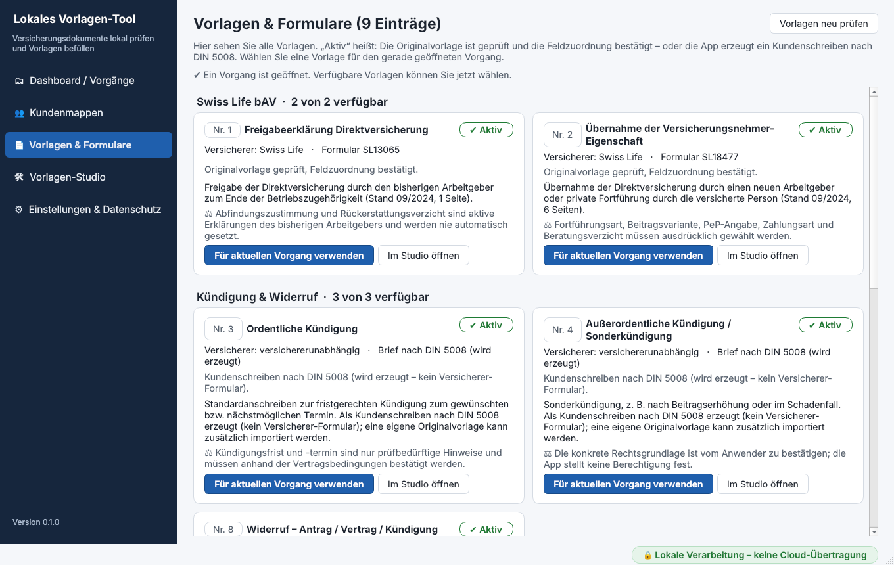

# Fehlende Vorlagen

**Kurz gesagt:**

- **1 Original fehlt und ist Pflicht:** Nr. 9 „Haftungsfreistellung Arbeitskraftabsicherung“ (tecis). Ohne das Original ist der Eintrag nicht nutzbar. Die App erzeugt diesen Text bewusst nicht selbst.
- **6 Einträge (Nr. 3–8) funktionieren schon heute** als Brief nach DIN 5008. Ein Original des Versicherers kann optional importiert werden. Erst nach Ihrer Bestätigung ersetzt es den Brief.
- Import ohne Programmierung im **Vorlagen-Studio**: importieren → zuordnen → prüfen und bestätigen → Status „Aktiv“.
- **Vorschlag für später:** „Wertermittlungsbogen Wohngebäude“ als Eintrag 10 – **nicht umgesetzt**.

---

## 1. Pflicht: Original fehlt

| Nr. | Vorlage | Gruppe | Status | Grund |
|---|---|---|---|---|
| 9 | Haftungsfreistellung Arbeitskraftabsicherung (z. B. Berufsunfähigkeit) – tecis | Betreuung & Enthaftung | **Originalvorlage fehlt** | Haftungsrelevante Erklärung der tecis. Der Wortlaut eines Dritten wird nicht nachgebaut. „Bitte die Originalvorlage der tecis importieren.“ |

**Was gebraucht wird:** das aktuelle Originalformular der tecis als PDF, am besten mit ausfüllbaren Formularfeldern. Bitte bei der tecis anfordern.

**Danach:** Import im Vorlagen-Studio (Abschnitt 3). Status zuerst „Zu prüfen“, nach Ihrer Bestätigung „Aktiv“.

---

## 2. Optional: Originale für die Briefeinträge

Diese Einträge nutzt die App heute als **Kundenschreiben nach DIN 5008** (Status „Aktiv“). Ein Original ist nur nötig, wenn der Versicherer ein eigenes Formular verlangt oder Sie es bevorzugen.

| Nr. | Eintrag | Versicherer laut Katalog | Mögliches Original |
|---|---|---|---|
| 3 | Ordentliche Kündigung – Standardanschreiben | versichererunabhängig | Kündigungsformular des jeweiligen Versicherers |
| 4 | Außerordentliche Kündigung / Sonderkündigung | versichererunabhängig | Formular des jeweiligen Versicherers |
| 5 | Befristete Beitragsfreistellung / Beitragsreduzierung | HDI | Antragsformular der HDI |
| 6 | Beitragserhöhung / Vertragsanpassung | Continentale | Antragsformular der Continentale |
| 7 | Bestandsübertrag / Betreuerwechsel an tecis AG | tecis | Formular der tecis bzw. des Versicherers, ggf. Maklervollmacht |
| 8 | Widerruf – Antrag / Vertrag / Kündigung | versichererunabhängig | Formular des jeweiligen Versicherers |

**Wichtig vor dem Import:**

- Solange das importierte Original noch nicht bestätigt ist („Zu prüfen“) oder fehlerhaft ist, verwendet die App für diesen Eintrag weiter den **Brief**. Der Katalog vermerkt dann: „Eine importierte Originalvorlage ist noch nicht aktiv (Zu prüfen).“
- Nach der Bestätigung füllt die App das **Formular** aus, nicht mehr den Brief. Das Studio fragt vor dem Import nach („Eigene Originalvorlage importieren?“).
- Zurück zum Brief geht es derzeit **nur von Hand**: App schließen und den Ordner `templates/<Katalog-ID>/` im Datenordner entfernen (vorher sichern). Eine Schaltfläche dafür gibt es noch nicht.
- Ein Formular gilt meist nur für **einen** Versicherer. Der Brief dagegen ist versichererneutral.

---

## 3. So importieren Sie ein Original im Vorlagen-Studio

1. **Vorlagen-Studio öffnen** – über die Seitenleiste oder im Katalog „Vorlagen & Formulare“ bei der Vorlage auf **„Im Studio öffnen“**.
2. Links unter „Vorlagen im Katalog“ den **Eintrag auswählen**.
3. **„Originalvorlage importieren …“** → PDF wählen. Bei Briefeinträgen fragt die App zuerst nach („Ja, importieren“).
   - Die App speichert eine **schreibgeschützte Kopie**. Ihre Datei bleibt unverändert.
   - Jeder Import ist eine **neue Version**. Bezeichnung: das Importdatum, z. B. `2026-11-13` (bei mehreren am selben Tag `2026-11-13-2` usw.).
   - Die App schlägt eine **erste Zuordnung** vor. Sie ordnet nur offensichtliche Vertragsdaten über den Feldnamen zu (z. B. „Versicherungsnummer“), erkennt Unterschriftsfelder und Datumsteile. **Ankreuzfelder und Optionsgruppen ordnet sie nie automatisch zu.** Eine Meldung zeigt, wie viele Felder zugeordnet sind und wie viele nicht.
4. **Feldzuordnung prüfen** – je PDF-Feld eine Zeile mit den Spalten PDF-Feld, Typ, Seite, Zustände, Art, Quelle (Datenfeld), Pflicht, Rechtlich relevant, Details, Hinweis.
   - Für jede Zeile **Art** und **Quelle** prüfen bzw. wählen. Felder ohne Bedeutung auf „– nicht zuordnen –“ lassen.
   - **„Vorschläge übernehmen“** setzt unsichere Vorschläge in leere Zeilen. Danach jede Zeile prüfen.
   - **Optionsgruppen:** Im Dialog „Optionsgruppe zuordnen“ jedem Zustand der PDF eine Auswahl zuweisen (z. B. Zustand `0` = „nein“).
   - **Unterschriftsfelder** sind fest auf „Unterschrift (bleibt leer)“ gesetzt.
   - **Pflicht** = ohne Wert kein Export. **Rechtlich relevant** = nur ausdrückliche Entscheidung der Nutzerin bzw. des Nutzers.
5. **„Testbefüllung mit Musterdaten“** – füllt die Vorlage mit erkennbar erfundenen Werten und zeigt die Seiten. Es wird nichts gespeichert.
6. Speichern:
   - **„Als Entwurf speichern“** → Status „Zu prüfen“ (noch nicht nutzbar).
   - **„Zuordnung prüfen & bestätigen“** → die App prüft die Zuordnung gegen die PDF und fragt nach. Nach Ihrer Bestätigung ist die Vorlage **„Aktiv“**.
7. Im Katalog erscheint der Eintrag nun als „Aktiv“ und kann in Vorgängen gewählt werden.

**Voraussetzungen für „Aktiv“** (prüft die App automatisch):

- Original vorhanden und Prüfsumme (SHA-256, digitaler Fingerabdruck der Datei) passt zur Zuordnung
- PDF lesbar, ohne Öffnungspasswort, kein XFA-Formular (eine ältere Formulartechnik, die nicht unterstützt wird), noch keine digitale Unterschrift enthalten
- Seitenzahl passt; alle zugeordneten Felder und Ankreuz-Zustände existieren im PDF mit passendem Feldtyp
- Ausfüllen ist laut PDF-Rechten erlaubt (oder die Felder werden per Koordinaten gesetzt)
- Zuordnung bestätigt

**Weitere Funktionen im Studio:**

- **„Paket exportieren …“** – speichert ein Vorlagenpaket (ZIP mit Original, Zuordnung und Prüfsumme, ohne Vorgangs- oder Personendaten). So lässt sich eine geprüfte Vorlage auf einen anderen Rechner übertragen.
- **„Paket importieren …“** – übernimmt ein Paket. Importierte Pakete müssen Sie **erneut prüfen und bestätigen**.
- **Versionen:** Ältere Versionen bleiben erhalten. Aktiv ist die neueste bestätigte importierte Version, sonst die mitgelieferte.
- **Koordinateneditor** – für PDFs **ohne** ausfüllbare Felder: Text wird an einer festen Stelle der Seite eingesetzt. Das ist eine **Grundfunktion** und weniger erprobt als das Ausfüllen echter Formularfelder.

**Grenzen:** PDFs bis 50 MB. Neue Datenfelder (z. B. für ein ganz neues Formular) lassen sich im Studio nicht anlegen; dafür ist eine Programmänderung in `src/insurance_app/core/fields.py` nötig.

---

## 4. Vorschlag: Eintrag 10 „Wertermittlungsbogen Wohngebäude“ (nicht umgesetzt)

**Status:** nur Idee. Es gibt dafür keinen Katalogeintrag, keine Felder und keine Tests.

**Wozu:** In der Wohngebäudeversicherung dient ein Wertermittlungsbogen üblicherweise dazu, die Versicherungssumme zu bestimmen (z. B. als „Wert 1914“) und so eine Unterversicherung zu vermeiden.

**Was dafür nötig wäre:**

| Schritt | Inhalt |
|---|---|
| Original | aktuelles Formular des jeweiligen Versicherers als PDF |
| Datenfelder | neue Felder in `core/fields.py`, z. B. Angaben zum Gebäude. Welche genau, hängt vom Formular ab. |
| Katalog | neuer Eintrag in `config/template_catalog.json`, ggf. neue Gruppe |
| Zuordnung | im Vorlagen-Studio, wie in Abschnitt 3 |
| Erkennung | ggf. neue Erkennungsregeln (`extraction/rules.py`), falls Werte aus Unterlagen gelesen werden sollen |
| Prüfung | Plausibilitätsregeln und Tests; fachliche Prüfung der Berechnungsgrundlage durch eine fachkundige Person |

Der Aufwand ist nicht geschätzt. Mehrere automatische Tests prüfen derzeit, dass der Katalog genau 9 Einträge hat. Sie müssten angepasst werden.
