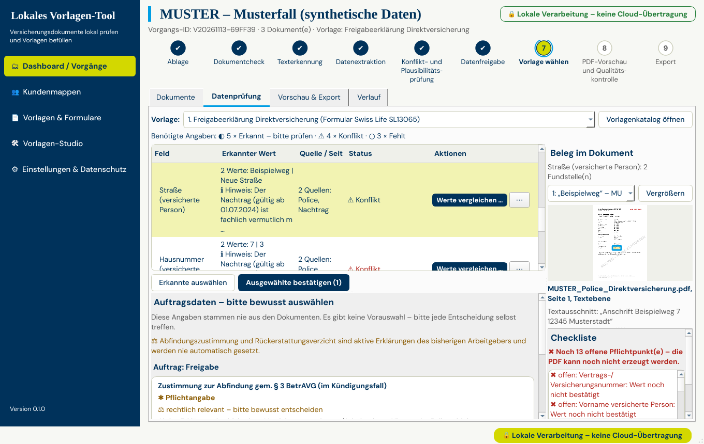

# Gestaltung nach dem tecis Styleguide

**Kurz gesagt:**

- Die Oberfläche folgt dem **tecis Corporate Design Manual, Version 1.0 (2020)**, Kapitel „Basiselemente“: Farben (Seiten 8–9) und Typografie (Seiten 10–11).
- Verwendet werden nur die vier Markenfarben, Schwarz und Weiß sowie erlaubte Aufrasterungen (hellere Töne).
- Schriften: **DM Sans** für Fließtext, **Tinos** nur für Überschriften. Beide liegen der App bei.
- **Eine bewusste Ergänzung:** drei Signalfarben für Prüfstatus und Fehler. Der Styleguide enthält dafür keine Farben.
- **Nicht verändert:** die erzeugten PDFs (Originalformulare der Versicherer und Kundenbriefe).

---

## 1. Farben

| Farbe | Wert laut Styleguide | Einsatz in der App |
|---|---|---|
| tecis Blau | `#00325b` | Navigation, Hauptschaltflächen, Schrift, erledigte Schritte |
| tecis Himmelblau | `#009ee3` | Gestaltungsfarbe: Balken an Überschriften, Rahmen bei Fokus, Ablagefläche, Markierung der Fundstelle |
| tecis Limette | `#d3d800` | Auswahl und Hervorhebung: gewählter Navigationspunkt, aktueller Schritt, Hinweis „Lokale Verarbeitung“ |
| tecis Sand | `#cbcdb9` | Rahmen und Linien; aufgerastert als Hintergrund |
| Schwarz | `#000000` | aufgerastert für Nebentexte (65 %) und deaktivierte Schrift (45 %) |
| Weiß | `#ffffff` | Karten, Eingabefelder, Schrift auf Blau |

### Aufrasterung

Regel im Styleguide: Aufrasterung nur zwischen 100 % und 15 %. tecis Blau wird nie aufgerastert. tecis Himmelblau nur in Infografiken.

| Ton | Einsatz |
|---|---|
| Sand 15 % | Seitenhintergrund |
| Sand 30 % | Tabellenköpfe, Hinweisboxen, deaktivierte Schaltflächen |
| Sand 50 % | deaktivierte Hauptschaltfläche |
| Limette 15 % | Erfolgsmeldungen, Ablagefläche beim Ziehen |
| Limette 30 % | ausgewählte Tabellenzeile, gedrückte Schaltfläche |

Die App setzt diese Regeln technisch durch: Die Funktion `tint()` in `src/insurance_app/ui/theme.py` lehnt eine Aufrasterung von tecis Blau, von tecis Himmelblau und unter 15 % ab.

### Farbkombinationen

Der Styleguide gibt vor, welche Farbe auf welcher Fläche stehen darf. So nutzt die App das:

| Fläche | Erlaubt laut Styleguide | In der App |
|---|---|---|
| tecis Blau | Himmelblau, Limette, Weiß | Navigation: weiße Schrift, beim Überfahren Limette; Hauptschaltflächen: weiße Schrift |
| tecis Himmelblau | nur Weiß | nur als Linie und Rahmen, nicht als Fläche mit Schrift |
| tecis Limette | Blau, Schwarz | gewählter Navigationspunkt und Hinweisplakette: Schrift in tecis Blau |
| tecis Sand | Blau, Schwarz | Tabellenköpfe und Hinweisboxen: Schrift in tecis Blau |

Nicht verwendet werden die gesperrten Kombinationen, zum Beispiel Weiß auf Limette oder Sand auf Blau.

## 2. Schriften

| Schrift | Vorgabe im Styleguide | In der App |
|---|---|---|
| **DM Sans** | Hausschrift für Fließtext und Zwischenüberschriften; Schnitte Regular, Medium, Bold | gesamte Oberfläche: Texte (Regular), Schaltflächen (Medium), Zwischenüberschriften und Hervorhebungen (Bold) |
| **Tinos** | ausschließlich für Überschriften; Schnitte Regular, Bold | Seitentitel und App-Name in der Navigation (Bold) |

- Beide Schriften liegen unter `assets/fonts/ui/` bei (SIL Open Font License, Lizenztexte im selben Ordner). Sie müssen nicht installiert werden.
- **Ersatz wie im Styleguide:** Kann DM Sans nicht geladen werden, nimmt die App Arial. Für Tinos ist Times New Roman der Ersatz.
- **Statussymbole** (zum Beispiel ◐ ✔ ⚠) sind in DM Sans nicht enthalten. Dafür nutzt die App eine Symbolschrift des Betriebssystems.

## 3. Bewusste Ergänzung: Signalfarben

Der Styleguide enthält keine Farben für Warnungen und Fehler. Die App muss offene Pflichtpunkte und Konflikte aber deutlich zeigen. Deshalb gibt es drei Signalfarben:

| Farbe | Wert | Einsatz |
|---|---|---|
| Grün | `#1E7B34` | „Bestätigt“, „Aktiv“, bestandene Prüfung |
| Ocker | `#8A5A00` | „Erkannt – bitte prüfen“, Hinweise |
| Rot | `#B3261E` | „Konflikt“, „Unklar“, offene Pflichtpunkte, Löschen |

- Sie erscheinen nur als Schrift, Symbol oder dünner Rahmen, nie als Fläche.
- Jeder Status hat zusätzlich ein Symbol und einen Text. Die Bedeutung hängt nie allein an der Farbe.
- Wenn tecis eigene Signalfarben vorgibt, lassen sie sich an einer Stelle austauschen (`OK`, `WARN`, `ERROR` in `theme.py`).

## 4. Was nicht umgestellt wurde

| Bereich | Grund |
|---|---|
| Originalformulare (Swiss Life SL13065, SL18477) | Die Vorlage des Versicherers bleibt unverändert. Die App füllt nur die Felder aus. |
| Kundenbriefe nach DIN 5008 | Absender ist die Kundin oder der Kunde, nicht tecis. Die Briefe bleiben neutral, in Liberation Sans. Diese Schrift ist maßgleich mit Arial, dem Office-Ersatz laut Styleguide. |
| tecis-Logo | Es lag keine Logodatei vor. Die App zeigt deshalb kein Logo. |

## 5. Absicherung durch Tests

`tests/test_ui/test_ui_brand.py` prüft automatisch:

- die Farbwerte gegen den Styleguide,
- die Regeln der Aufrasterung,
- dass im Stylesheet nur Markenfarben, erlaubte Aufrasterungen und die drei Signalfarben stehen,
- dass außerhalb von `theme.py` keine Farbe fest eingetragen ist,
- dass DM Sans und Tinos beiliegen und verwendet werden,
- dass nur die Schriftstärken Regular, Medium und Bold vorkommen.
